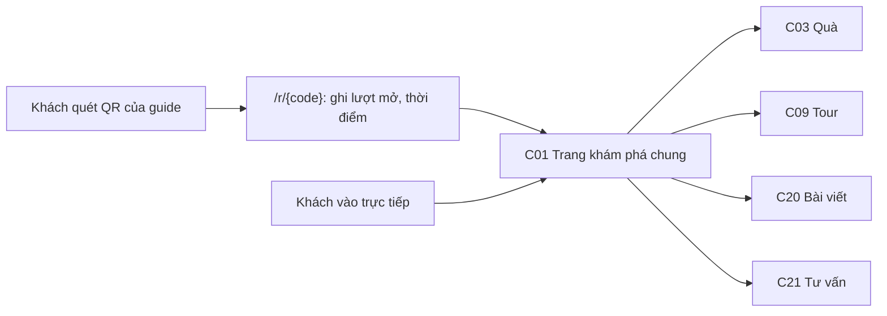
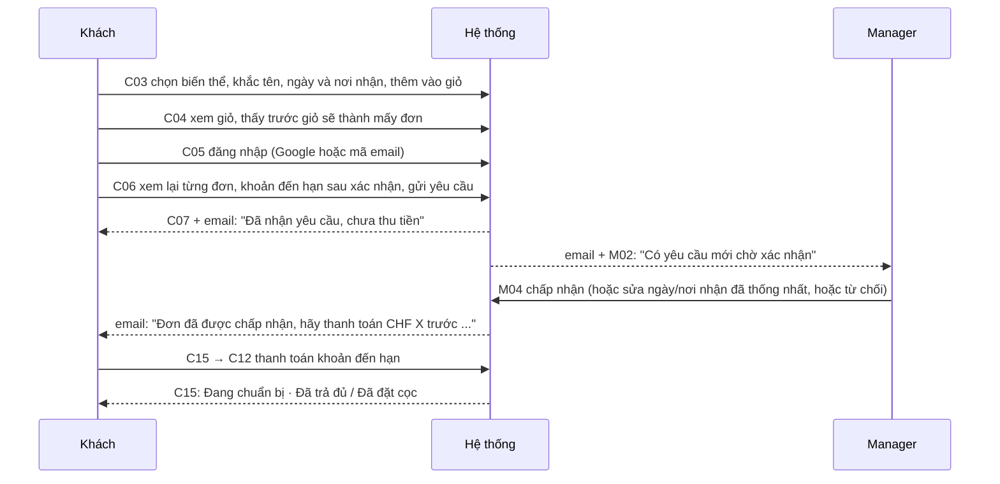
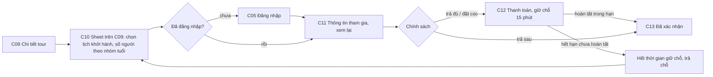

# Đặc tả UX Phase 1: Swiss Stories & Gifts

Phiên bản nháp 2 · Cập nhật 14/10/2026 · Nguồn yêu cầu: `docs/PRD/Swiss_Stories_and_Gifts_PRD_v2.md` (bản đã cập nhật quyết định)

Tài liệu này mô tả trải nghiệm Phase 1 cho khách, Owner, Store Manager và đối tác giới thiệu. Luồng Super Admin trong Phase 1 chỉ dùng để mời và kích hoạt cửa hàng đầu tiên của Chị Ngọc; mở thêm merchant độc lập thuộc giai đoạn sau. Đây là **đặc tả thiết kế**, chưa có prototype hay kiểm thử tự động. Mỗi màn hình có một mã (ví dụ `C03`, `M04`) để đối chiếu khi dựng prototype sau này.

Quy ước nhãn:

- **PRD** là yêu cầu đã chốt trong PRD, ghi kèm mục.
- **Đề xuất UX** là quy tắc thiết kế chưa được duyệt. Các đề xuất chính được gom ở mục 7 để chủ sản phẩm xác nhận; màn hình và kịch bản nào phụ thuộc đề xuất phải giữ nhãn này khi dựng prototype.

Tên thương hiệu chưa chốt (O01). Tài liệu tạm dùng "Swiss Stories & Gifts"; prototype sau này cần cho phép thay tên khi được duyệt.

---

## 1. Nguyên tắc và ràng buộc

1. **Điện thoại trước.** Khách thường mở link từ QR trên xe hoặc tại khách sạn. Mọi màn hình khách được thiết kế cho chiều rộng 375px trước. Dashboard merchant dùng được trên điện thoại cho thao tác hằng ngày (xác nhận đơn, ghi thu, hoàn tất), và mở rộng thành bố cục hai cột trên máy tính. (PRD 1.2)
2. **Tách ba câu hỏi của khách.** Khách luôn trả lời được: đơn đã được người bán xác nhận chưa, tôi đã trả bao nhiêu và còn nợ bao nhiêu, giao dịch đã hoàn tất chưa. Giao diện dùng hai nhãn riêng: nhãn **tiến độ** và nhãn **thanh toán**. Không gộp hai thông tin vào một trạng thái. (PRD 1.2, 8)
3. **Không hứa vượt khả năng.** Ngày và nơi nhận khách chọn được ghi là "yêu cầu" cho đến khi người bán chấp nhận. Không có chữ "giao hàng" hay "đảm bảo ngày". Chữ "AI" chỉ dùng cho trợ lý tư vấn C21 (R19, chốt 14/10/2026), không dùng để hứa kết quả. (PRD 1.2, 6.2, 12)
4. **Xem không cần tài khoản, mua thì đăng nhập ngay trong luồng.** Khách xem nội dung, thêm vào giỏ và chọn ngày khi chưa đăng nhập. Bước đăng nhập (Google hoặc mã email) xuất hiện ngay trước khi gửi yêu cầu hoặc đặt tour, rồi đưa khách về đúng bước đang làm. Giỏ và lựa chọn được giữ nguyên. (PRD 5, AC01)
5. **Giao diện và thông báo hệ thống hỗ trợ EN và DE.** Nội dung sản phẩm/tour do merchant viết được xuất bản bằng một ngôn ngữ; thiếu bản dịch khách chọn thì hiện bản đầy đủ đang có kèm thông báo rõ ngôn ngữ (R02 đã chốt), kể cả chính sách/hướng dẫn trong checkout và giao dịch. Không tự dịch hoặc ghép các đoạn của hai bản. Tiền và ngày định dạng theo `en-CH` hoặc `de-CH`, giờ Europe/Zurich, nhưng ý nghĩa giống nhau. Giao diện merchant Phase 1 cũng có EN và DE. (PRD 4.1, AC30)
6. **Merchant ít quen công nghệ.** Màn hình đầu tiên của merchant là danh sách việc cần làm theo thứ tự ưu tiên, không phải biểu đồ. Mỗi thao tác tiền có xác nhận lại và ghi rõ hệ quả. (PRD 1.2, 6.4)
7. **Không lộ dữ liệu cá nhân ra ngoài vai trò.** Đối tác chỉ thấy tên khách trên giao dịch được ghi nguồn cho mình; không thấy email, số điện thoại, địa chỉ liên hệ/giao nhận, nội dung khắc hoặc yêu cầu tùy chỉnh. Analytics không chứa tên khắc, email hay nội dung tự do. (PRD 10.3, 13.3)
8. **Giao dịch giữ phiên bản lúc đặt.** Trang chi tiết đơn hiển thị giá, chính sách và tỷ lệ hoa hồng theo thời điểm đặt, kể cả khi merchant đã sửa sản phẩm sau đó. (PRD 8, AC15)

---

## 2. Mô hình trạng thái

Đây là nền đề xuất cho mọi màn hình. Các trạng thái và chuyển trạng thái chưa được kiểm chứng bằng prototype hoặc hệ thống chạy thật.

### 2.1 Tiến độ đơn hàng hóa

Năm trạng thái đầu dùng đúng tên trong PRD 6.2. "Đã bàn giao" là **Đề xuất UX** để hiển thị trường hợp đã giao nhưng còn nợ (PRD 8).

| Mã | Tiếng Việt | EN | DE | Ý nghĩa với khách |
| --- | --- | --- | --- | --- |
| `requested` | Chờ người bán xác nhận | Awaiting seller confirmation | Wartet auf Bestätigung | Yêu cầu đã gửi, chưa trả tiền, ngày và nơi nhận chưa được hứa |
| `accepted` | Người bán đã chấp nhận, chờ thanh toán | Accepted, payment due | Angenommen, Zahlung fällig | Ngày và nơi nhận đã được chấp nhận; cần trả khoản đến hạn để người bán bắt đầu chuẩn bị |
| `preparing` | Đơn đã xác nhận, đang chuẩn bị | Confirmed, being prepared | Bestätigt, in Vorbereitung | Đơn chắc chắn; người bán đang chuẩn bị |
| `ready` | Sẵn sàng bàn giao | Ready for pickup | Abholbereit | Đến nơi nhận đã thống nhất |
| `handed_over` | Đã bàn giao (Đề xuất UX) | Handed over | Übergeben | Đã nhận hàng; nếu còn nợ thì vẫn hiện số dư |
| `completed` | Hoàn tất | Completed | Abgeschlossen | Đã nhận hàng và đã trả đủ; mở đánh giá |
| `declined` | Người bán không nhận đơn | Declined by seller | Vom Verkäufer abgelehnt | Kèm lý do; không có khoản thu |
| `cancelled` | Đã hủy | Cancelled | Storniert | Kèm lý do và tình trạng hoàn tiền nếu có |
| `partially_refunded` | Đã hoàn một phần | Partially refunded | Teilweise erstattet | Có khoản hoàn thực tế một phần, hiện số tiền đã hoàn; hoa hồng điều chỉnh theo dòng |
| `refunded` | Đã hoàn tiền | Refunded | Erstattet | Đã hoàn toàn bộ; dashboard đối tác tự tính lại số tiền hoa hồng (O08/O10) |

Chuyển trạng thái:

| Từ | Đến | Ai thực hiện | Điều kiện |
| --- | --- | --- | --- |
| (giỏ) | `requested` | Khách | Đã đăng nhập; ngày yêu cầu hợp lệ theo lịch chuẩn bị từng dòng (AC04); chưa thu tiền (AC25) |
| `requested` | `requested` | Owner, Manager | Sửa ngày hoặc nơi nhận đã thống nhất qua email; bắt buộc ghi chú; lưu lịch sử (AC26) |
| `requested` | `accepted` | Owner, Manager | Kiểm tra và giữ đủ tồn toàn bộ đơn tại lúc chấp nhận; khoản đến hạn > 0 (trả đủ hoặc đặt cọc) |
| `requested` | `preparing` | Owner, Manager | Kiểm tra và giữ đủ tồn toàn bộ đơn tại lúc chấp nhận; chính sách không trả trước (AC07) |
| `requested` | `declined` | Owner, Manager | Bắt buộc lý do; các đơn khác cùng giỏ không bị ảnh hưởng |
| `accepted` | `preparing` | Hệ thống | Provider xác nhận khoản đến hạn đã thu |
| `accepted` | `cancelled` | Khách; Owner, Manager; hệ thống | Khách hủy trước khi trả; merchant hủy theo chính sách; hệ thống tự hủy khi hết hạn chưa trả khoản đầu (R05), lưu lý do và thông báo |
| `preparing` | `ready` | Owner, Manager | Hàng đã sẵn sàng tại nơi nhận |
| `ready` | `handed_over` | Owner, Manager | Khách đã nhận hàng |
| `handed_over` | `completed` | Owner, Manager | Số dư bằng 0 (AC09, AC10). Nút bị khóa và giải thích khi còn nợ |
| `preparing`, `ready` | `cancelled` | Owner, Manager | Theo chính sách hủy; mở luồng hoàn tiền nếu đã thu (AC14) |
| `completed` | `partially_refunded` hoặc `refunded` | Owner, Manager | Ghi nhận khoản hoàn thực tế theo dòng ở M10; lưu lịch sử và tự điều chỉnh số tiền hoa hồng, không đổi tỷ lệ lúc đặt (O08/O10) |
| `partially_refunded` | `partially_refunded` hoặc `refunded` | Owner, Manager | Hoàn bổ sung trong giới hạn còn có thể hoàn; không điều chỉnh hoa hồng trùng |

Khi `ready` và số dư bằng 0, merchant có một nút gộp "Đã bàn giao và hoàn tất".

**O05 — Giữ tồn đã chốt:** giỏ và `requested` chưa giữ hàng. Khi merchant chấp nhận, kiểm tra lại và giữ đủ từng SKU cho toàn bộ đơn, bảo đảm chấp nhận đồng thời không vượt tồn; thiếu bất kỳ dòng nào thì không chuyển trạng thái hoặc gửi yêu cầu thanh toán. Cả đơn không trả trước cũng giữ tồn tại thời điểm chấp nhận. Hủy giải phóng phần hàng chưa bàn giao đang giữ, kể cả tự hủy quá hạn khoản đầu. Bàn giao chuyển phần giữ thành hàng đã xuất; hoàn tiền không tự cộng lại tồn hàng đã bàn giao.

### 2.2 Tiến độ booking tour

| Mã | Tiếng Việt | EN | DE | Ý nghĩa với khách |
| --- | --- | --- | --- | --- |
| `pending_payment` | Đang giữ chỗ để thanh toán | Seat held for payment | Platz für Zahlung reserviert | Giữ chỗ 15 phút khi khách tạo booking cần thanh toán ngay hoặc đặt cọc |
| `expired` | Hết thời gian giữ chỗ | Reservation expired | Reservierung abgelaufen | Chưa hoàn tất thanh toán trong 15 phút; chỗ đã được trả lại, khách phải đặt lại nếu còn chỗ |
| `confirmed` | Đã xác nhận, đã giữ chỗ | Confirmed, seats held | Bestätigt, Plätze reserviert | Có chỗ trên lịch khởi hành; có thể còn số dư |
| `delivered` | Dịch vụ tour đã cung cấp | Tour service delivered | Tourleistung erbracht | Tour đã kết thúc và merchant xác nhận **booking này** được cung cấp dịch vụ; nếu còn nợ vẫn hiện số dư |
| `completed` | Hoàn tất | Completed | Abgeschlossen | Đã tham gia và đã trả đủ; mở đánh giá |
| `no_show` | Khách vắng mặt | No-show | Nicht erschienen | Merchant ghi nhận khách không tham gia tour; không hoa hồng hoặc đánh giá dù được giữ tiền theo chính sách |
| `cancelled` | Đã hủy | Cancelled | Storniert | Kèm lý do: khách hủy, merchant hủy, hoặc quá hạn thanh toán và chỗ đã được trả lại (AC27) |
| `partially_refunded` | Đã hoàn một phần | Partially refunded | Teilweise erstattet | Có khoản hoàn thực tế một phần, hiện số tiền đã hoàn; hoa hồng điều chỉnh theo dòng |
| `refunded` | Đã hoàn tiền | Refunded | Erstattet | Đã hoàn toàn bộ; dashboard đối tác tự tính lại số tiền hoa hồng (O08/O10) |

| Từ | Đến | Ai thực hiện | Điều kiện |
| --- | --- | --- | --- |
| (chọn lịch) | `pending_payment` | Khách | Gửi booking trả đủ hoặc đặt cọc; hệ thống giữ số chỗ đã chọn trong 15 phút từ thời điểm tạo giữ chỗ thành công |
| `pending_payment` | `confirmed` | Hệ thống | Provider xác nhận khoản thu **khi giữ chỗ còn hiệu lực** (AC06) |
| `pending_payment` | `expired` | Hệ thống | Hết 15 phút mà chưa hoàn tất thanh toán; đóng phiên thanh toán và trả chỗ. Khách phải tạo booking mới nếu còn khả dụng (AC05, R06) |
| (chọn lịch) | `confirmed` | Khách | Chính sách không trả trước; không cần thẻ (PRD 6.3, AC07) |
| `confirmed` | `cancelled` | Hệ thống | Chỉ khi chính sách tour quy định tự hủy sau hạn và thời gian gia hạn đã hết; chỗ được trả lại (AC27) |
| `confirmed` | `cancelled` | Khách; Owner, Manager | Theo chính sách hủy; hoàn tiền nếu đã thu |
| `confirmed` | `delivered` | Owner, Manager | Sau khi tour kết thúc và xác nhận dịch vụ đã cung cấp cho booking này; không suy ra từ giờ khởi hành hay thao tác ở cấp lịch |
| `delivered` | `completed` | Owner, Manager | Số dư bằng 0 |
| `confirmed` | `no_show` | Owner, Manager | Merchant xác nhận khách không đến tham gia tour; giữ trạng thái tiền riêng, không tự hoàn tất/hoàn tiền/miễn nợ |
| `completed` | `partially_refunded` hoặc `refunded` | Owner, Manager | Ghi nhận khoản hoàn thực tế theo dòng ở M10; lưu lịch sử và tự điều chỉnh số tiền hoa hồng, không đổi tỷ lệ lúc đặt (O08/O10) |
| `partially_refunded` | `partially_refunded` hoặc `refunded` | Owner, Manager | Hoàn bổ sung trong giới hạn còn có thể hoàn; không điều chỉnh hoa hồng trùng |

**O10 — No-show đã chốt:** Owner/Manager đánh dấu booking khách không đến là `no_show`; không chuyển `delivered`/`completed`, không hoa hồng hoặc quyền đánh giá dù merchant giữ tiền theo chính sách. Giữ khoản thu và trạng thái tiền riêng; thao tác no-show không tự hoàn tiền hoặc miễn nợ. Chính sách thu/hoàn tiền cụ thể, đổi lịch và merchant hủy tour còn mở ở PRD O10. Tour không diễn ra phải xử lý riêng, không đánh dấu khách no-show. Màn hình lịch có thể hỗ trợ thao tác theo lô, nhưng mỗi booking phải có kết quả riêng và người vận hành phải xác nhận trước khi ghi nhận cung cấp dịch vụ.

**R06 đã chốt ngày 13/10/2026:** giữ chỗ 15 phút cho lần thanh toán đầu của booking tour trả đủ hoặc đặt cọc. Hết hạn khi chưa hoàn tất thanh toán thì booking hết hiệu lực và chỗ được giải phóng; khách thấy "Thời gian giữ chỗ đã hết. Vui lòng chọn lịch và đặt lại". Nút đặt lại kiểm tra chỗ và giá hiện tại. Tải lại trang không kéo dài thời hạn. Booking không trả trước được xác nhận theo chính sách tour; trả số dư của booking đã xác nhận không tạo lại đồng hồ giữ chỗ này.

**Yêu cầu kỹ thuật:** phiên thanh toán phải được đóng/hủy khi giữ chỗ hết hạn theo khả năng provider; kết quả thanh toán và thời hạn giữ chỗ phải được đối soát để không bán vượt chỗ hoặc xác nhận hai lần. Thông báo đến muộn phải xét thời điểm thanh toán thực sự, không chỉ thời điểm website nhận thông báo. Không tự khôi phục một booking đã hết hiệu lực. Nếu tiền vẫn phát sinh sau khi booking hết hiệu lực, ghi ngoại lệ tiền để đối soát/hoàn theo cơ chế provider được kiểm chứng; không biến thành luồng khách chờ merchant tìm chỗ mặc định.

### 2.3 Thanh toán (nhãn thứ hai)

Thanh toán là nhãn riêng, tính từ tổng tiền, các khoản đã thu, khoản hoàn và hạn thu. Chính sách được giữ theo phiên bản lúc đặt.

| Nhãn | Khi nào | Ví dụ hiển thị |
| --- | --- | --- |
| Chưa đến hạn | Đơn hàng hóa đang `requested` | "Chưa cần thanh toán. Bạn chỉ trả sau khi người bán xác nhận." |
| Cần thanh toán | Có khoản đến hạn chưa trả | "Cần trả CHF 54.00 trước 14.10.2026" |
| Đã đặt cọc | Đã thu một phần | "Đã trả CHF 26.70 · Còn CHF 62.30, hạn 20.10.2026" |
| Trả sau | Không trả trước, chưa thu | "Trả sau · CHF 89.00, hạn 18.10.2026" |
| Quá hạn | Quá hạn thu, chưa trả | "Quá hạn CHF 62.30" (màu cảnh báo) |
| Đã trả đủ | Số dư bằng 0 | "Đã trả đủ CHF 89.00" |
| Hoàn tiền đang xử lý | Khoản hoàn chưa được xác nhận thành công | "Đang xử lý hoàn CHF 54.00"; chưa điều chỉnh như khoản hoàn thành công |
| Hoàn tiền thất bại | Khoản hoàn thất bại | "Hoàn CHF 54.00 thất bại"; chưa ghi đã hoàn |
| Đã hoàn một phần | Có khoản hoàn thành công một phần | "Đã hoàn một phần CHF 20.00"; hiện lịch sử thu và hoàn riêng |
| Đã hoàn tiền | Đã hoàn toàn bộ tiền của giao dịch | "Đã hoàn toàn bộ CHF 54.00" |

Mỗi khoản tiền là một dòng trong **lịch sử thanh toán**:

- **Online:** chỉ ghi khi provider xác nhận. Khi đang chờ, hiện "Đang xử lý", không cộng vào đã thu.
- **Thu bên ngoài:** số tiền, cách thu (tiền mặt, chuyển khoản, khác), thời điểm, người ghi. Owner và Manager đều ghi được. (PRD 9.1)
- **Điều chỉnh:** chỉ Owner; tham chiếu khoản gốc, bắt buộc lý do; khoản gốc vẫn hiện, gạch ngang. (PRD 9.1, AC29)
- **Hoàn tiền:** yêu cầu → đang xử lý → thành công hoặc thất bại. Hủy không tự nghĩa là đã hoàn. (AC14)

Hệ thống chặn ghi khoản thu làm số dư âm và cảnh báo khi vừa có khoản cùng số tiền trong 10 phút (chống ghi trùng, AC08).

**Đã chốt O08/O10:** Owner/Manager cập nhật đơn hoặc booking sang `partially_refunded` hoặc `refunded` từ M10 kèm dòng sản phẩm/tour và số tiền hoàn thực tế, lý do, phương thức, thời điểm và người ghi. Giao dịch đã `completed` được chuyển hiển thị sang Đã hoàn một phần hoặc Đã hoàn tiền theo số tiền hoàn, giữ lịch sử hoàn tất và khoản thu gốc. Hoàn online đối chiếu provider; đang xử lý/thất bại không được hiển thị như đã hoàn thành. Hoàn sau hoàn tất không bắt buộc thao tác hủy trước. Phase 1 hỗ trợ cả hoàn toàn bộ và một phần; không làm phát sinh lại dư nợ của khoản đã hoàn. Nhãn hoàn tiền không thay việc ghi nhận kết quả cung cấp hàng/dịch vụ; giữ kết quả trước hoàn trong lịch sử. Các dòng `partially_refunded` và `refunded` trong mục 2.1 và 2.2 mô tả trạng thái tổng hợp khách thấy; giao diện vẫn tách tiến độ thực hiện và tình trạng thanh toán.

### 2.4 Hoa hồng của một giao dịch

| Nhãn | Khi nào | Ai thấy |
| --- | --- | --- |
| Ước tính, chưa ghi nhận | Giao dịch có nguồn đối tác, chưa hoàn tất | Merchant, đối tác (ghi rõ "ước tính") |
| Đã ghi nhận | Giao dịch chuyển `completed`; ghi đúng một lần (AC10) | Merchant, đối tác |
| Đã trả | Merchant ghi khoản chi cho đối tác (AC13) | Merchant, đối tác |
| Không phát sinh | Giao dịch bị hủy hoặc từ chối trước khi hoàn tất; booking no-show dù merchant giữ tiền | Merchant, đối tác |
| Đã điều chỉnh do hoàn tiền | Merchant ghi nhận `partially_refunded` hoặc `refunded`; hệ thống tự tính lại số tiền hoa hồng theo khoản hoàn, giữ tỷ lệ lúc đặt | Merchant, đối tác; giữ lịch sử khoản đã chi, không tự thu lại tiền |

**O08 — Cơ sở tính đã chốt:** hoa hồng từng dòng = (giá sản phẩm/tour + phí cá nhân hóa − giảm giá − phần hoàn thuộc cơ sở) × tỷ lệ lúc đặt; các thành phần này không gồm thuế. Loại thuế, giao nhận và phí thanh toán thu thêm từ khách (nếu có) khỏi cơ sở. Không trừ thêm chi phí xử lý thanh toán merchant trả cho provider; chi phí này được nhập/đối chiếu tại M24 để tính lãi đóng góp. Phí khắc dùng tỷ lệ sản phẩm liên quan. M04/M07/M10/M16 và P02 cho đối chiếu cơ sở tính, tỷ lệ và khoản điều chỉnh; không lộ nội dung cá nhân hóa trong P02. Hoàn riêng thuế/giao nhận/phí thanh toán không làm giảm hoa hồng. Phân bổ giảm giá chung và làm tròn theo dòng cần đặc tả để tổng khớp giao dịch.

**O08 — Bù trừ đã chốt:** khoản trả dư do hoàn tiền tự bù vào hoa hồng phát sinh tiếp theo đã được ghi nhận của cùng đối tác tại cùng merchant; không dùng hoa hồng ước tính, không bù chéo merchant/đối tác. Phần chưa bù hết chuyển kỳ sau. Sổ hoa hồng lưu khoản điều chỉnh và từng lần bù trừ; khoản chi thực tế giữ nguyên, bù trừ không ghi như tiền mới đã chuyển. Hiện riêng còn cần bù trừ và tiền còn phải trả sau bù trừ, không dùng số tiền phải trả âm để thay thông tin khoản trả dư.

Nguồn giới thiệu được khóa trên giao dịch lúc đặt. Cửa sổ 30 ngày, last-click (PRD 10.1, AC11).

### 2.5 Một giỏ, nhiều đơn

Khi khách gửi yêu cầu, giỏ được tách thành nhóm theo merchant, chính sách thanh toán, ngày và nơi/phương án nhận. Mỗi nhóm là một đơn (PRD 8.1, B5, R12). Trong Phase 1 chỉ có một merchant. Những món cùng chính sách nhưng khác ngày hoặc nơi nhận vẫn tách đơn; mỗi đơn có một ngày và nơi/phương án nhận, được xác nhận và theo dõi riêng (**R12 đã chốt ngày 13/10/2026**).

---

## 3. Kiến trúc thông tin

### 3.1 Storefront của khách

```
/{lang}/                         C01 Trang khám phá chung
├── /gifts                       C02 Keepsakes / Andenken (lọc theo danh mục con của cửa hàng)
│   └── /gifts/{slug}            C03 Chi tiết quà
├── /tours                       C08 Tour
│   ├── /tours/{slug}            C09 Chi tiết tour; ?book=true mở C10 Chọn lịch và số người (sheet trên C09)
│   │   └── /book/review         C11 Xem lại → C12 nếu đến hạn trả ngay → C13 Đã đặt
│   └── /private-tour            C22 Yêu cầu tour private
├── /stories                     C19 Câu chuyện (blog)
│   └── /stories/{slug}          C20 Bài viết và bình luận
├── /plan                        C21 Tư vấn chuyến đi (widget, cũng mở được từ nút nổi)
├── /cart                        C04 Giỏ quà → C05 Đăng nhập → C06 Xem lại và gửi yêu cầu → C07 Đã gửi yêu cầu
└── /account                     C14 Giao dịch của tôi
    ├── /orders/{id}             C15 Chi tiết đơn hàng hóa → C12 Thanh toán khoản đến hạn
    ├── /bookings/{id}           C16 Chi tiết booking → C12 Thanh toán số dư
    └── /review/{id}             C18 Viết đánh giá
/r/{partnerCode}                 Link giới thiệu: ghi nguồn rồi chuyển tới trang đích
```

Thanh điều hướng dưới trên điện thoại có bốn mục: Khám phá, Keepsakes (DE: Andenken), Tour, Tài khoản. Nhãn "Gifts/Geschenke" đã bỏ từ 15/10/2026 (R20); đường dẫn `/gifts` giữ nguyên. Giỏ nằm ở góc trên, có số lượng. Nút "Tư vấn chuyến đi" nổi ở góc dưới bên phải trên C01, C09 và C20.

### 3.2 Dashboard merchant (Owner và Manager)

```
/store
├── Hôm nay              M02 Việc cần làm, tiền cần thu, hoa hồng cần trả
├── Đơn hàng             M03 Danh sách đơn quà (tab: Chờ xác nhận, Chờ thanh toán, Đang chuẩn bị, Sẵn sàng, Còn nợ, Hoàn tất, Đã hủy)
│   └── {id}             M04 Chi tiết đơn quà
├── Lịch                 M27 Calendar tổng hợp booking và đơn quà (đề xuất route /store/calendar; hiện chỉ lab)
├── Booking              M05 Lịch khởi hành sắp tới
│   ├── {departure}      M06 Danh sách khách của một lịch khởi hành
│   └── {booking}        M07 Chi tiết booking
├── Sản phẩm             M11 Danh sách sản phẩm (tab: Keepsakes, Tours, Stays (Soon), Experiences (Soon), Pickup points)
│   ├── categories       M26 Danh mục (/store/products/categories): danh mục con của Keepsakes, mở từ liên kết "Manage categories" ở M11
│   ├── {product}        M12 Sửa keepsake (EN/DE, danh mục con, biến thể, khắc, chuẩn bị, chính sách, hoa hồng)
│   └── {tour}           M13 Sửa tour và lịch khởi hành
├── Đối tác              M15 Đối tác giới thiệu
│   └── {partner}        M16 Chi tiết đối tác, QR, link báo cáo, sổ hoa hồng
├── Nội dung             M17 Bài viết (theo ngôn ngữ) · M18 Bình luận · M23 Đánh giá
├── Yêu cầu              M19 Yêu cầu tư vấn · M20 Yêu cầu tour private
├── Báo cáo              M21 Phễu, nguồn, nhóm khách, sản phẩm, vận hành, tiền, lãi đóng góp, hành vi
│   └── chi-phi          M24 Dữ liệu chi phí thực tế (R14 đã chốt)
└── Cài đặt              M14 Điểm nhận · M22 Thành viên, tài khoản nhận tiền, chính sách, widget
```

Thao tác tiền mở dạng bảng trượt từ dưới lên (sheet) để giữ ngữ cảnh: M08 Ghi nhận khoản thu, M09 Điều chỉnh khoản thu, M10 Hủy và hoàn tiền.

Manager không thấy: M22 phần thành viên và tài khoản nhận tiền; nút điều chỉnh hoặc hủy khoản thu trong M04 và M07 (AC29). Owner và Manager đều được thực hiện hoàn tiền qua M10 (R11a) và ghi nhận hoa hồng đã chi qua M16 (R11b), có lịch sử thao tác.

### 3.2a M27 — Merchant Calendar: hướng chỉ có lịch, 15/10/2026

**Trạng thái:** A · Month overview, B · Week planner và C · Day workspace đã bị chủ sản phẩm từ chối. Lý do: quá nhiều phần ngoài lịch, không có cảm giác mobile-native. Đặc tả bên dưới thay thế các phương án đó. Hướng mới thực hiện đúng yêu cầu chủ sản phẩm; giao diện mới vẫn chờ duyệt.

**Bố cục:** `/lab/calendar` mở trực tiếp lịch toàn màn hình. Không có hero, thẻ lựa chọn phương án, bộ đếm, search/filter, danh sách bên cạnh hay prototype bar. Toolbar chỉ có tháng/năm bấm để chọn ngày, Today, Previous và Next. Day / Week / Month là ba chế độ của cùng một lịch. Mobile đặt bộ chuyển ở đáy trong vùng an toàn; desktop đặt phía phải toolbar. Dữ liệu và lựa chọn ngày được giữ khi chuyển chế độ.

| Chế độ | Hiển thị và tương tác |
| --- | --- |
| Month | Lưới tháng chiếm phần màn hình còn lại. Ô ngày và thẻ sự kiện dùng nội dung React riêng. Mobile dùng tên ngắn và giờ; `+N more` mở ngày đó trong Day, không giấu giao dịch. Chạm ngày mở Day. |
| Week | Bảy ngày theo trục giờ, ngày nhận quà ở hàng riêng trên cùng. Mobile cuộn ngang bên trong lịch, giữ Week; giờ cuộn dọc. Header ngày có thể mở Day. |
| Day | Một ngày theo trục giờ, hiện đầy đủ đơn nhận trong ngày ở hàng trên. Sự kiện có giờ, tên và khách khi đủ chỗ. Ngày trống vẫn là lưới giờ trống có ngày được ghi rõ. |

**Điều hướng:** Previous/Next dịch một ngày, tuần hoặc tháng theo chế độ hiện tại. Today về ngày mẫu 15/10/2026. Tiêu đề tháng mở sheet chọn ngày với lùi/tiến tháng; chọn ngày đóng sheet và chuyển lịch chính tới ngày đó, giữ chế độ. Month/Day hỗ trợ vuốt ngang trên khoảng trống để đổi kỳ; Week dùng cuộn ngang tự nhiên. Nút bấm luôn có sẵn thay cho gesture.

**Chi tiết theo yêu cầu:** chạm sự kiện mở sheet dùng Drawer của hệ thống, có đóng/Escape, focus và nền phủ. Hiện tên, ngày/giờ, khách, địa điểm, trạng thái vận hành, tiền và ghi chú mẫu. Không có thao tác ghi giao dịch. Quà chờ merchant xác nhận ghi Requested pickup date. Booking hủy không nằm trong lịch mẫu đang vận hành.

**Thiết kế và kỹ thuật:** FullCalendar React 7.1.2 cung cấp tính ngày, lưới và điều hướng. Toolbar, nội dung ô ngày, header và thẻ sự kiện được tùy biến; dùng các hook `dayCellTopContent`, `dayHeaderContent`, `eventContent`, `navLinkDayClick` để giữ điều hướng bàn phím. Token kế thừa theme dự án; nền sáng, Inter, ngày hôm nay màu nhấn Swiss red, tour và quà có màu riêng. Không thêm dark mode. Hàng quà gọn, ưu tiên không gian lịch theo giờ.

**Giới hạn lab:** cố định October 2026, múi giờ Europe/Zurich. Chỉ các nhãn điều khiển có EN/DE; nội dung nghiệp vụ mẫu còn tiếng Anh. Chú thích dữ liệu mẫu nằm trong date picker/detail, không chiếm lịch chính. Không backend, lưu dữ liệu, kéo thả đổi lịch, thao tác tiền hoặc kiểm quyền phía server. M03–M07 giữ vai trò nghiệp vụ; M27 chưa được tích hợp vào menu merchant.

**Kiểm tra trước duyệt:** full-screen ở 375/390px và desktop; Day/Week/Month; chọn ngày, Today, lùi/tiến qua tháng/năm; Month mở Day; toàn bộ việc trong ngày bận; ngày trống; mở/đóng sheet; bàn phím và Escape; vuốt đổi kỳ và cuộn trong Week; không cuộn ngang toàn trang. Bằng chứng mới nằm ở `docs/ux/prototype/reports/calendar/v2/`; báo cáo A/B/C là lịch sử bị từ chối.

**Tham chiếu:** [Google Calendar — Day, Week, Month](https://support.google.com/calendar/answer/6110849?hl=en), [Google Calendar Android](https://support.google.com/calendar/answer/6110849?co=GENIE.Platform%3DAndroid&hl=en), [FullCalendar React](https://fullcalendar.io/docs/react). Tham khảo hành vi và sự tập trung vào lịch, giữ design system dự án.

### 3.3 Báo cáo đối tác

```
/partner/{reportToken}   P01 Nhập mã gửi tới email đã đăng ký → P02 Báo cáo
```

Link giới thiệu công khai (`/r/{partnerCode}`) và link báo cáo (`/partner/{reportToken}`) khác nhau và không dùng thay nhau (PRD 10.3).

### 3.4 Super Admin: khởi tạo cửa hàng đầu tiên ở Phase 1

```
/admin                   A01 Mời và theo dõi điều kiện mở bán của Chị Ngọc
/store/onboarding        A02 Chị Ngọc nhận lời mời, hoàn tất điều kiện mở bán
```

Cấu trúc quyền và dữ liệu phải sẵn sàng cho nhiều merchant độc lập. Giao diện Super Admin để mời và quản lý **merchant tiếp theo** chỉ bật ở giai đoạn mở rộng, không là kết quả cần bàn giao của Phase 1.

---

## 4. Luồng chính

### 4.1 Từ QR đến khám phá (AC24, AC11)



- Link đối tác ghi lượt mở rồi chuyển tới trang đích, thường là C01. Không hiện chữ "bạn được giới thiệu bởi" để tránh gây hiểu lầm về giá.
- Khách không phải chọn nhóm khách. C01 có các khối nội dung: "Có 2 giờ ở Lucerne?" (quà nhận nhanh, walking story), "Vài ngày ở đây?" (Hidden Lucerne, câu chuyện), "Quà khắc tên", "Câu chuyện địa phương", "Cần gợi ý cho chuyến đi?".
- Lượt mở mới nhất trong 30 ngày thắng. Khi khách đăng nhập, nguồn đang giữ được gắn vào tài khoản cùng thời điểm mở link (PRD 10.1).

### 4.2 Mua quà: giỏ, yêu cầu, xác nhận, thanh toán (AC04, AC25, AC26, AC28)



Chi tiết từng bước:

1. **C03 Chi tiết quà.** Khách chọn biến thể (kích thước, thiết kế), số lượng, nội dung khắc nếu có. Ngày nhận chọn trên lịch: ngày sớm nhất tính theo số ngày chuẩn bị và chế độ ngày làm việc của sản phẩm; ngày không hợp lệ bị làm mờ và có giải thích "Cần 3 ngày làm việc để khắc". Nơi nhận chọn từ danh sách merchant cấu hình, mỗi nơi có địa chỉ và giờ mở cửa. Dòng nhắc cố định: "Đây là ngày bạn yêu cầu. Người bán sẽ xác nhận trước khi bạn thanh toán."
2. **C04 Giỏ quà.** Các món được nhóm sẵn thành "Đơn 1", "Đơn 2" theo chính sách thanh toán và ngày/nơi nhận. Mỗi nhóm có giải thích ngắn: "Trả đủ sau khi xác nhận" hoặc "Đặt cọc 30% sau khi xác nhận". Nếu một ngày nhận chung không hợp lệ cho mọi món trong nhóm, dòng bị lỗi được đánh dấu và đề xuất ngày sớm nhất hợp lệ (AC04).
3. **C05 Đăng nhập.** Sheet trượt lên: "Tiếp tục với Google" hoặc nhập email nhận mã 6 số. Sau khi nhập mã, khách quay lại đúng C06.
4. **C06 Xem lại và gửi yêu cầu.** Mỗi đơn hiện các món, ngày và nơi nhận yêu cầu, tổng tiền, **khoản sẽ đến hạn sau khi người bán xác nhận**, chính sách hủy. Tổng chung chỉ để tham khảo. Nút chính: "Gửi yêu cầu · chưa thanh toán". (AC25, AC28)
5. **C07 Đã gửi yêu cầu.** Liệt kê các đơn đã tạo và trạng thái "Đang chờ người bán xác nhận", không hiển thị thời gian phản hồi dự kiến (R03 đã chốt). Nhắc ngày nhận là yêu cầu chưa được xác nhận; có khối tùy chọn "Giúp chúng tôi hiểu chuyến đi của bạn" (hồ sơ chuyến đi, mục 4.9). C03/C06/C15 và email đã nhận yêu cầu cũng không đưa thời gian phản hồi dự kiến.
6. **M04 (merchant) chấp nhận.** Xem mục 4.6.
7. **C15 Chi tiết đơn.** Sau khi chấp nhận, khối nổi bật "Cần thanh toán CHF X trước ...", kèm thông báo đơn sẽ tự hủy nếu không trả khoản đầu trong hạn. Nút "Thanh toán" mở C12. Hết hạn chưa trả khoản đầu thì hiện "Đã hủy — Quá hạn thanh toán", bỏ nút thanh toán cũ và có hành động gửi yêu cầu mới để merchant xác nhận lại ngày nhận. Không tự gửi yêu cầu hoặc giữ nguyên xác nhận cũ. Nếu chính sách là trả sau, đơn đi thẳng tới "Đang chuẩn bị" và hiện số dư với hạn thu (AC07); không áp dụng tự hủy khoản đầu cho đơn này hoặc số dư sau đặt cọc.

Hai đơn từ một giỏ được xác nhận, thanh toán, hủy và hoàn tiền độc lập. Nếu một đơn bị từ chối, đơn còn lại không bị ảnh hưởng và khách nhận email riêng cho từng đơn.

### 4.3 Đặt tour (AC05, AC06, AC07, AC27)



- **C10.** Sheet trượt lên trên C09 khi bấm nút đặt tour, giống sheet "Quà của bạn" trên C03; tiêu đề là tên tour. Lịch khởi hành dạng danh sách theo ngày, mỗi dòng có giờ, giá theo nhóm tuổi và số chỗ còn lại. Lịch hết chỗ bị làm mờ. Bộ đếm người lớn, trẻ em, em bé; ghi rõ nhóm nào chiếm chỗ. Nút chính rộng hết sheet "Xem lại booking · CHF {tổng}" mở C11.
- **Địa chỉ của C10.** Sheet mở bằng `/tours/{slug}?book=true` trên C09; đường dẫn cũ `/tours/{slug}/book` chuyển về đó. Tải lại trang, Back từ C11 và nút sửa lịch hoặc nhóm trên C11 mở lại sheet với lựa chọn đã giữ. Back của trình duyệt, nút X hoặc vuốt xuống đóng sheet và ở lại C09, không để lại bước lịch sử khiến hai màn hình quay vòng.
- **C11.** Tên người liên hệ, số điện thoại để guide liên lạc trong ngày, và các trường tham gia merchant cấu hình. Khối tiền: "Trả hôm nay", "Còn lại", "Hạn trả".
- **Trả sau.** Nút là "Đặt chỗ · trả sau". Không hỏi thẻ. C13 hiện rõ "Đã giữ chỗ. Cần trả CHF 89.00 trước 18.10.2026. Nếu chưa trả, booking sẽ bị hủy và chỗ được trả lại theo chính sách tour." (PRD 6.3, AC27)
- **Hai người đặt chỗ cuối cùng.** Người giữ chỗ thành công trước được ưu tiên trong 15 phút; người sau thấy "Lịch này vừa hết chỗ" và được gợi ý lịch gần nhất. Thanh toán thất bại có thể thử lại trong thời gian còn lại; hết hạn chưa hoàn tất thì trả chỗ và yêu cầu đặt lại. Đối soát kết quả provider đến muộn không tự lấy lại chỗ đã nhả hoặc khôi phục booking hết hiệu lực (AC05, O05).

### 4.4 Trả số dư

Từ email nhắc hoặc từ C14, khách mở C15 hoặc C16, bấm "Thanh toán CHF X" và đi tới C12. Sau khi provider xác nhận, nhãn thanh toán đổi theo số dư thực tế. Nếu provider chưa trả kết quả, hiện "Đang xử lý thanh toán" và không cho bấm trả lần nữa. Thanh toán số dư của booking đã xác nhận không tạo giữ chỗ mới; chính sách quá hạn số dư áp dụng theo R07.

### 4.5 Đăng nhập

- Khách: Google hoặc mã 6 số qua email. Mã hết hạn sau 10 phút, tối đa 5 lần thử (**Đề xuất UX**). Không có mật khẩu.
- Nhân sự: cùng cơ chế Google hoặc mã email (**Đề xuất UX**, vì O07 còn mở). Lời mời Manager mở M01: "Chị Ngọc mời bạn làm Store Manager của cửa hàng ...". Sau khi đăng nhập, bấm "Chấp nhận lời mời".

### 4.6 Merchant xử lý yêu cầu đơn quà (AC25, AC26)

M04 hiển thị một khối quyết định ở đầu trang khi đơn là `requested`:

- **Chấp nhận.** Hiện tồn khả dụng từng dòng và nhắc hàng chỉ được giữ khi chấp nhận. Xác nhận lại: "Bạn xác nhận chuẩn bị được 2 món này để khách nhận ngày 15.10.2026 tại Cửa hàng phố cổ. Khách sẽ được yêu cầu trả CHF 54.00." Khi thực hiện, kiểm tra lại và giữ đủ toàn bộ đơn; nếu tồn vừa thay đổi thì giữ trạng thái chờ, nêu dòng thiếu và không gửi yêu cầu thanh toán.
- **Sửa ngày hoặc nơi nhận.** Dùng khi đã thống nhất với khách qua email. Bắt buộc ghi chú. Sau khi lưu, đơn vẫn là `requested` để merchant chấp nhận theo giá trị mới. Lịch sử đơn ghi "Ngày nhận đổi từ 14.10 thành 15.10 · lý do · người sửa".
- **Không nhận đơn.** Chọn lý do (hết hàng, không kịp ngày, khác) và ghi chú gửi khách.
- Nút "Gửi email cho khách" mở ứng dụng email với tiêu đề có mã đơn, vì việc trao đổi diễn ra ngoài hệ thống (PRD 6.2).

### 4.7 Ghi thu bên ngoài, hoàn tất, điều chỉnh (AC08, AC09, AC10, AC29)

- **M08 Ghi nhận khoản thu.** Số tiền (mặc định bằng số dư), cách thu, thời điểm (mặc định bây giờ), ghi chú. Nút xác nhận ghi rõ: "Ghi nhận CHF 62.30 tiền mặt. Số dư sẽ là CHF 0.00."
- **Hoàn tất.** Chỉ bật khi hàng đã bàn giao hoặc **booking tour này** đã được xác nhận cung cấp dịch vụ **và** số dư bằng 0. Khi bị khóa, nút giải thích lý do: "Còn nợ CHF 62.30", "Chưa bàn giao" hoặc "Chưa xác nhận kết quả tour cho booking này". Sau khi hoàn tất: hoa hồng chuyển "Đã ghi nhận", khách nhận lời mời đánh giá, đơn lưu người và thời điểm hoàn tất.
- **M09 Điều chỉnh khoản thu (chỉ Owner).** Từ một dòng trong lịch sử thanh toán: "Sửa số tiền" hoặc "Hủy khoản này". Bắt buộc lý do. Khoản gốc vẫn hiện, gạch ngang, kèm khoản điều chỉnh. Manager không thấy hai nút này; nếu Manager mở link trực tiếp, hiện "Chỉ Owner được điều chỉnh khoản thu".
- **M10 Hủy và hoàn tiền.** Với hủy trước hoàn tất: hủy theo chính sách, rồi tạo hoàn online qua provider hoặc ghi hoàn bên ngoài; hủy không đồng nghĩa đã hoàn tiền. Với giao dịch đã hoàn tất: Owner/Manager dùng hành động "Ghi nhận đã hoàn tiền", chọn dòng sản phẩm/tour, nhập số tiền hoàn từng dòng, lý do, phương thức và thời điểm; hiển thị trạng thái `partially_refunded` hoặc `refunded` sau khi hoàn được xác nhận, giữ lịch sử hoàn tất và tiền. Hệ thống tự tính lại số tiền hoa hồng theo khoản hoàn và tỷ lệ lúc đặt, cập nhật P02/M21, ghi điều chỉnh một lần. Không tự đổi tỷ lệ sản phẩm hoặc thu tiền từ đối tác. Hỗ trợ hoàn toàn bộ/một phần: hiện khoản đã hoàn và phần còn có thể hoàn của từng dòng, chặn vượt tiền thực thu hoặc giá trị còn lại của dòng. Hoa hồng theo giá trị đủ điều kiện còn lại của dòng × tỷ lệ lúc đặt; cơ sở dòng được hoàn toàn bộ thì hoa hồng dòng về 0. Hoa hồng đã chi dư tự bù trừ theo mục 2.4; cơ sở tính đã chốt ở mục 2.4; phân bổ giảm giá chung/làm tròn theo dòng cần đặc tả.

### 4.8 Đối tác và hoa hồng (AC12, AC13)

- **M16 Chi tiết đối tác.** QR tải về được (PNG, in được), link giới thiệu để sao chép, link báo cáo riêng, email đã đăng ký. Sổ hoa hồng gồm các giao dịch, trạng thái hoa hồng và lịch sử chi. Hiện khoản trả dư, từng lần bù trừ và phần còn cần bù trừ. Nút "Ghi nhận đã trả" mở sheet: số tiền (mặc định bằng còn phải trả sau bù trừ), cách trả, ngày; không coi số đã bù trừ là tiền chi mới.
- **P01.** Đối tác mở link báo cáo, thấy tên cửa hàng và email đã che một phần ("g***@hotel-lucerne.ch"). Bấm "Gửi mã", nhập 6 số. Link bị chuyển tiếp một mình không mở được báo cáo.
- **P02.** Bộ lọc ngày, tuần, tháng. Ba con số lớn: Hoa hồng được hưởng sau điều chỉnh, Tiền thực tế đã trả, Còn phải trả sau bù trừ. Khi có trả dư, hiện thêm "Đã bù trừ" và "Còn cần bù trừ" cùng lịch sử, kể cả khoản chuyển từ kỳ trước. Hiển thị số đơn, giá trị và hoa hồng tổng hợp theo kỳ và nhóm sản phẩm, cùng danh sách từng đơn/booking: mã tham chiếu, ngày đặt, tên khách, sản phẩm, giá trị, trạng thái và hoa hồng. Dòng ước tính có nhãn "Ước tính, chưa ghi nhận". Tên khách là thông tin cá nhân duy nhất được hiển thị; không có email, số điện thoại, địa chỉ liên hệ/giao nhận, nội dung khắc, ghi chú hoặc yêu cầu tùy chỉnh khác. Chỉ xem giao dịch được ghi nguồn cho chính đối tác (R15 đã chốt).

### 4.9 Hồ sơ chuyến đi (PRD 3.1)

Ba câu hỏi, đều tùy chọn: "Bạn đi theo đoàn hay tự túc?", "Bạn đến Lucerne ngày nào?", "Bạn rời Lucerne ngày nào?". Hiện ở C07 sau khi gửi yêu cầu mua hàng (trước xác nhận/thanh toán) và C13 sau khi booking được xác nhận (**R09 đã chốt**). Câu trả lời gắn với từng đơn hàng hoặc booking, không phải một hồ sơ chung của khách (chốt 14/10/2026): một lần gửi trên C07 tạo nhiều đơn thì lưu cho mọi đơn của lần gửi đó. Nếu một đơn hoặc booking khác của khách đã có ngày đến và ngày rời đi bao trùm ngày nhận hoặc ngày tour của giao dịch này, biểu mẫu điền sẵn các câu trả lời đó; nếu không thì để trống. Khách có thể bỏ qua, bổ sung và sửa trên thẻ "Chuyến đi của bạn" ở tab Tổng quan của C15/C16; sửa trên C15 chỉ áp dụng cho đơn đó. Không dùng hồ sơ này để thay thế ngày nhận hàng hoặc ngày tour. Báo cáo phân loại từng giao dịch theo câu trả lời của chính nó; thiếu dữ liệu phân nhóm thì xếp vào "Chưa xác định". Địa điểm áp dụng cho ngày đến/rời và cách phân nhóm vẫn cần chốt trước pilot (O13).

### 4.10 Tư vấn chuyến đi (PRD 12, AC18)

C21 là cuộc trò chuyện với trợ lý AI của cửa hàng (R19, chốt 14/10/2026): trợ lý chào, rồi hỏi từng câu theo thứ tự cố định của cửa hàng dưới dạng tin nhắn. Lựa chọn (chọn một, chọn nhiều) hiện ngay trong cuộc trò chuyện dưới câu hỏi, theo kiểu lựa chọn quà ở C03; số, ngày (mở lịch dạng sheet) và văn bản nhập ở khung soạn cuối màn hình. Trợ lý hiện "đang nhập" ngắn trước câu tiếp theo; tiêu đề và khung soạn cố định, chỉ cuộc trò chuyện cuộn (tham khảo widget Chatwoot, docs/ux/research/chatwoot-widget.md). Câu trả lời hiện như tin nhắn của khách, câu tùy chọn có "Bỏ qua". Ở giai đoạn này trợ lý không trả lời câu hỏi tự do và không tạo kế hoạch. Không yêu cầu đăng nhập; trợ lý hỏi email liên hệ, bắt buộc trước khi gửi (R08 đã chốt). Sau câu cuối, trợ lý hiện thẻ tóm tắt với "Gửi" và "Sửa câu trả lời". Sau khi gửi: "Cảm ơn. Đội ngũ cửa hàng đã nhận thông tin và sẽ liên hệ với bạn qua email để tiếp tục tư vấn." Không hứa thời hạn phản hồi khi merchant chưa duyệt cam kết. Giai đoạn sau trợ lý là tác tử AI trò chuyện thật (O19). Câu hỏi và lựa chọn trả lời hiển thị theo EN hoặc DE; yêu cầu lưu kèm bản câu hỏi, ngôn ngữ và câu trả lời tại lúc gửi.

### 4.11 Blog, bình luận, đánh giá (AC16, AC17)

- C19 chỉ liệt kê bài có trong ngôn ngữ đang chọn. C20 là trang blog theo R17: ảnh bìa, tác giả, mục lục theo phần, ảnh, video và audio thu sẵn. C20 hiện quà và tour do merchant chọn cho phiên bản ngôn ngữ đó (R16), rồi phần "Khám phá thêm" với tối đa 3 bài khác (R18). Bình luận hiện 3 chuỗi gần nhất; xem tất cả trong sheet.
- Bình luận: chưa đăng nhập thì ô bình luận đổi thành nút "Đăng nhập để bình luận".
- Đánh giá: chỉ mở từ đơn hoặc booking `completed` của chính khách (C15, C16 → C18). Mỗi sản phẩm trong giao dịch một đánh giá, 1–5 sao và nội dung. Đánh giá hiện nhãn "Đã mua". Trang sản phẩm có dòng "Chỉ khách đã mua và hoàn tất giao dịch mới đánh giá được."

### 4.12 Super Admin và cửa hàng đầu tiên (AC03)

- A01 trong Phase 1: Super Admin mời **Chị Ngọc** làm Owner của cửa hàng đầu tiên và xem trạng thái lời mời/xác minh. Danh sách và luồng mời nhiều merchant độc lập thuộc giai đoạn mở rộng.
- A02: Chị Ngọc thấy danh sách điều kiện mở bán: thông tin cửa hàng, tài khoản nhận tiền đã xác minh với provider, ít nhất một sản phẩm hoặc tour, chính sách. Nút "Mở bán" chỉ bật khi đủ điều kiện.
- Super Admin không có mục blog hay nội dung (PRD 4.2).

### 4.13 Merchant đọc báo cáo và chi phí (PRD 13)

M02 ưu tiên việc cần làm; mỗi thẻ dẫn tới danh sách giao dịch liên quan. M21 dùng bộ lọc kỳ, đối tác hoặc loại nguồn, nhóm khách, hàng hóa/tour và sản phẩm. Tóm tắt đầu trang tách **giá trị đơn/booking**, **tiền đã thu**, **dư nợ**, **hoàn tiền** và **hoa hồng**; không cộng các số này thành một doanh thu chung. Hàng hóa và tour có số liệu riêng.

Các góc nhìn phía dưới gồm phễu mở QR/link → xem nội dung → bắt đầu đặt → gửi yêu cầu hoặc booking → thanh toán → hoàn tất; tỷ lệ và điểm rời từng bước; sản phẩm/SKU bán chạy; tồn và chỗ; booking đã cung cấp dịch vụ, no-show, hủy; hiệu quả bài viết, CTA và widget. "Lượt mở URL từ QR" không được gọi là số lượt quét vật lý chắc chắn. Chỉ số hành vi có thể thiếu khi người dùng không cho phép đo hoặc trình duyệt chặn tracking; giao diện hiện mức đủ dữ liệu, không thay phần thiếu bằng 0. Số tiền và trạng thái giao dịch lấy từ dữ liệu nghiệp vụ, không chỉ từ sự kiện trình duyệt.

Lãi đóng góp chỉ tính khi đủ chi phí thực tế của giao dịch (**R14 đã chốt**, PRD 13.2). M24 cho nhập/đối chiếu giá vốn, đóng gói, phí thanh toán, giao nhận và các chi phí biến đổi áp dụng; mỗi khoản có trạng thái "thực tế" hoặc "chưa có". Khoản không phát sinh phải được xác nhận là 0; ô trống không có nghĩa là 0. Không dùng chi phí mặc định hoặc ước tính để tính lãi. Khi thiếu chi phí, M21 hiện "Chưa đủ dữ liệu tính lãi" kèm danh sách khoản thiếu và link bổ sung. Báo cáo tổng hợp nêu mức đầy đủ dữ liệu, không trình bày lãi của một phần giao dịch như lãi toàn bộ nhóm/kỳ. Công thức doanh thu và quyền nhập/điều chỉnh chi phí còn phải chốt ở O14.

---

## 5. Danh mục màn hình

Mỗi màn hình có trạng thái trống, đang tải và lỗi theo mẫu chung (mục 5.5). Bảng chỉ ghi những trạng thái riêng.

### 5.1 Khách

| Mã | Màn hình | Nội dung chính | Trạng thái riêng |
| --- | --- | --- | --- |
| C01 | Trang khám phá chung | Hero "Lucerne, a place you always want to return to", khối theo thời gian ở địa phương, rail bốn danh mục (Keepsakes, Tours, Stays, Experiences; Stays và Experiences gắn "Soon", không mở được), quà nổi bật, tour, câu chuyện, tư vấn | Có nguồn đối tác hoặc không (không hiển thị khác biệt) |
| C02 | Keepsakes / Andenken | Lưới sản phẩm, lọc theo danh mục con của cửa hàng (chỉ hiện danh mục con có ít nhất một keepsake đã xuất bản), giá từ, "Nhận sớm nhất: thứ Năm". Tìm kiếm "Browse" hiện các danh mục con này cùng Tours | Danh mục con trống |
| C03 | Chi tiết quà | Ảnh, câu chuyện, biến thể, khắc tên (đếm ký tự), số lượng, ngày nhận, nơi nhận, chính sách thanh toán và hủy, đánh giá | Hết hàng; biến thể không bán; ngày không hợp lệ |
| C04 | Giỏ quà | Nhóm theo đơn, ngày và nơi nhận từng nhóm, tạm tính | Giỏ trống; dòng có ngày không hợp lệ |
| C05 | Đăng nhập (sheet) | Google, email, nhập mã 6 số | Mã sai; mã hết hạn; gửi lại sau 30 giây |
| C06 | Xem lại và gửi yêu cầu | Từng đơn, khoản đến hạn sau xác nhận, chính sách, nút gửi | Lỗi tồn thay đổi khi gửi |
| C07 | Đã gửi yêu cầu | Các đơn đã tạo, bước tiếp theo, hồ sơ chuyến đi tùy chọn | Đã trả lời hồ sơ |
| C08 | Danh sách tour | Thẻ tour, thời lượng, giá từ, lịch gần nhất | Tour chưa mở bán ("Sắp có", không đặt được) |
| C09 | Chi tiết tour | Mô tả, lịch trình, bao gồm và không bao gồm, điểm gặp, điều kiện, giá theo nhóm tuổi, chính sách | Không còn lịch |
| C10 | Chọn lịch và số người (sheet trên C09) | Danh sách lịch, chỗ còn, bộ đếm theo nhóm tuổi | Hết chỗ; vượt số chỗ |
| C11 | Thông tin và xem lại booking | Liên hệ, thông tin tham gia, tiền hôm nay và còn lại, hạn trả | Lịch vừa hết chỗ |
| C12 | Thanh toán | Trang thanh toán của provider (mô phỏng khi có prototype), số tiền, đơn liên quan; đồng hồ 15 phút cho lần thanh toán đầu booking tour trả đủ/đặt cọc | Đang xử lý; thất bại; hết hạn giữ chỗ và nút đặt lại |
| C13 | Booking đã xác nhận | Tóm tắt, nhãn thanh toán, thêm vào lịch, hồ sơ chuyến đi | Trả sau |
| C14 | Giao dịch của tôi | Danh sách đơn và booking, mỗi dòng có hai nhãn | Chưa có giao dịch |
| C15 | Chi tiết đơn quà | Dòng thời gian, hai nhãn, khối hành động (thanh toán, hủy, liên hệ cửa hàng kèm mã đơn), ngày và nơi nhận đã xác nhận, lịch sử thanh toán, chính sách theo lúc đặt | Mỗi trạng thái ở mục 2.1; khách cần trao đổi ngày/nơi nhận |
| C16 | Chi tiết booking | Như C15, thêm lịch khởi hành, điểm gặp, số người và cách liên hệ cửa hàng | Mỗi trạng thái ở mục 2.2; thanh toán đến sau khi nhả chỗ, khách vắng mặt không hoa hồng/đánh giá, tiền theo chính sách |
| C18 | Viết đánh giá | Sao, nội dung, sản phẩm được đánh giá | Đã đánh giá |
| C19 | Câu chuyện | Danh sách bài theo ngôn ngữ | Không có bài trong ngôn ngữ này |
| C20 | Bài viết | Ảnh bìa, tác giả, ngày đăng và thời gian đọc, mục lục theo phần, ảnh, video, audio; quà và tour liên kết (R16, R17); "Khám phá thêm" tối đa 3 bài (R18); 3 chuỗi bình luận, xem tất cả trong sheet | Bài chỉ có ở ngôn ngữ khác; bài không có liên kết thì ẩn phần quà/tour |
| C21 | Tư vấn chuyến đi | Trò chuyện với trợ lý AI: câu hỏi dạng tin nhắn, ô nhập theo loại câu hỏi, câu trả lời dạng tin nhắn, thẻ tóm tắt với Gửi/Sửa, lời cảm ơn (R19) | Câu bắt buộc chưa trả lời; thiếu email; câu chưa có bản dịch; đã gửi |
| C22 | Yêu cầu tour private | Số người, ngày mong muốn, sở thích, email | Đã gửi |
| C23 | Hồ sơ chuyến đi (đã bỏ 14/10/2026) | Thay bằng thẻ "Chuyến đi của bạn" ở tab Tổng quan của C15/C16 (mục 4.9) | — |

### 5.2 Merchant

| Mã | Màn hình | Nội dung chính | Khác biệt Owner và Manager |
| --- | --- | --- | --- |
| M01 | Chấp nhận lời mời | Tên cửa hàng, người mời, vai trò, đăng nhập, chấp nhận | Không |
| M02 | Hôm nay | Thẻ việc: chờ xác nhận, chờ khách thanh toán, cần chuẩn bị, sẵn sàng bàn giao, tour sắp chạy, quá hạn thu, đã thực hiện nhưng còn nợ. Ba con số: tiền còn phải thu, hoa hồng còn phải trả, giao dịch hoàn tất tuần này | Không |
| M03 | Đơn quà | Tab theo trạng thái, mỗi dòng có hai nhãn, ngày nhận, nơi nhận | Không |
| M04 | Chi tiết đơn quà | Khối quyết định hoặc hành động tiếp theo, món và nội dung khắc, khách, nguồn, lịch sử thanh toán, hoa hồng, nhật ký | Owner có nút điều chỉnh khoản thu |
| M05 | Lịch khởi hành | Danh sách theo ngày, chỗ đã đặt/tổng, số dư còn phải thu, booking cần đối soát tiền hoặc kết quả tham gia | Không |
| M06 | Khách của lịch khởi hành | Booking, số người, liên hệ, nhãn thanh toán; ghi kết quả cung cấp dịch vụ cho từng booking sau khi tour kết thúc, đánh dấu trường hợp khách vắng mặt không hoa hồng/đánh giá, tiền theo chính sách | Không |
| M07 | Chi tiết booking | Như M04 cho tour | Owner có nút điều chỉnh khoản thu |
| M08 | Ghi nhận khoản thu (sheet) | Số tiền, cách thu, thời điểm, ghi chú, xác nhận | Không |
| M09 | Điều chỉnh khoản thu (sheet) | Khoản gốc, số tiền mới hoặc hủy, lý do | Chỉ Owner |
| M10 | Hủy và hoàn tiền (sheet) | Lý do, dòng sản phẩm/tour, số tiền hoàn từng dòng, đã hoàn và còn có thể hoàn, hoàn toàn bộ/một phần, online hoặc bên ngoài; xác nhận trước khi thực hiện, lưu người/thời điểm/kết quả | Owner và Manager đều được hoàn tiền; không sửa khoản thu gốc |
| M11 | Sản phẩm | Tab Keepsakes, Tours, Stays (Soon), Experiences (Soon), Pickup points; trạng thái xuất bản, đủ EN/DE chưa. Tab Keepsakes có hai bộ lọc chọn nhiều dạng dropdown (Status: Active/Archived; Sub-category) hiện thành chip bỏ được, và liên kết "Manage categories" tới M26. Stays/Experiences: trống, không sản phẩm, không trình soạn thảo | Không |
| M12 | Sửa keepsake | Tab EN và DE, Category (chỉ đọc "Keepsakes") và Sub-category (select, bắt buộc để xuất bản; nháp lưu được khi chưa chọn; thay cho danh sách danh mục phẳng cũ; nếu cửa hàng chưa có danh mục con thì có liên kết sang M26), biến thể và tồn, khắc tên, ngày chuẩn bị và chế độ ngày, nơi nhận áp dụng, chính sách thanh toán gồm hạn trả khoản đầu theo sản phẩm, chính sách hủy, tỷ lệ hoa hồng | Không |
| M13 | Sửa tour | Tab EN và DE cho mô tả, lịch trình, dịch vụ bao gồm/không bao gồm, điểm gặp; nhóm tuổi, lịch khởi hành và số chỗ, giá theo lịch, chính sách, hoa hồng | Không |
| M14 | Điểm nhận | Tên, địa chỉ, giờ mở cửa, hướng dẫn EN và DE | Không |
| M15 | Đối tác | Danh sách, loại, lượt mở 30 ngày, giao dịch, còn phải trả | Không |
| M16 | Chi tiết đối tác | QR, link, link báo cáo, sổ hoa hồng, ghi nhận đã trả với số tiền/thời điểm/phương thức/thông tin đối soát/người ghi, thu hồi link | Owner và Manager đều ghi chi; thu hồi link chỉ Owner theo đề xuất R10 |
| M17 | Bài viết | Danh sách theo ngôn ngữ, nháp và đã xuất bản; trình soạn thảo theo phần (đề mục, đoạn văn, ảnh, video YouTube, audio tải lên), tác giả, ảnh bìa; chọn và sắp xếp tối đa 6 quà/tour đang xuất bản để liên kết (R16, R17) và tối đa 3 bài cho "Khám phá thêm" (R18) | Không |
| M18 | Bình luận | Ẩn, xóa, trả lời | Không |
| M19 | Yêu cầu tư vấn và cấu hình widget | Hộp yêu cầu; câu hỏi và lựa chọn trả lời theo EN/DE, thứ tự, loại trả lời, bắt buộc; trạng thái thiếu bản dịch, email nhận | Không |
| M20 | Yêu cầu tour private | Hộp yêu cầu, trạng thái đã trả lời | Không |
| M21 | Báo cáo | Các góc nhìn: phễu QR/link → xem → đặt → xác nhận → thanh toán → hoàn tất; nguồn và tỷ lệ chuyển đổi; bốn nhóm khách và "chưa xác định"; sản phẩm/SKU và tour; tồn/chỗ, hủy, no-show; tiền (giá trị giao dịch, đã thu, dư nợ, hoàn, hoa hồng); lãi đóng góp và mức đủ dữ liệu chi phí; hành vi nội dung, click CTA, bước rời phễu và lỗi checkout | Không |
| M24 | Dữ liệu chi phí thực tế cho báo cáo | Nhập hoặc đối chiếu giá vốn, đóng gói, phí thanh toán, giao nhận và chi phí biến đổi khác theo giao dịch; đánh dấu còn thiếu, xác nhận khoản không phát sinh bằng 0; không dùng ước tính để tính lãi | Không |
| M22 | Cài đặt | Thông tin cửa hàng, thành viên và lời mời, tài khoản nhận tiền, chính sách mặc định | Manager chỉ thấy thông tin cửa hàng |
| M23 | Đánh giá | Danh sách, phản hồi; không có nút xóa | Không |
| M26 | Danh mục (Categories) | Đường dẫn `/store/products/categories`; thanh quay lại Products; tiêu đề có hành động "Add sub-category". Bốn thẻ danh mục cố định theo thứ tự Keepsakes, Tours, Stays (Soon), Experiences (Soon). Thẻ Keepsakes là danh sách danh mục con chỉnh được: mỗi dòng có tên, số sản phẩm, tên ở ngôn ngữ còn lại và menu ⋯ (Rename, Move up, Move down, Delete). Thêm/đổi tên trong sheet dưới (tên EN, tên DE). Thẻ Tours có liên kết tới tab Tours; thẻ Stays/Experiences ghi chưa mở. Mở từ liên kết "Manage categories" ở M11 và từ M12 khi cửa hàng chưa có danh mục con | Lỗi nếu cả hai tên trống; lỗi nếu tên trùng danh mục con khác; danh mục con còn sản phẩm: Delete bị chặn, hiện số sản phẩm; chưa có danh mục con: trạng thái trống |

### 5.3 Đối tác

| Mã | Màn hình | Nội dung chính | Trạng thái riêng |
| --- | --- | --- | --- |
| P01 | Xác minh email | Tên cửa hàng, email che một phần, gửi mã, nhập mã | Mã sai; link đã bị thu hồi |
| P02 | Báo cáo | Kỳ, ba con số, tổng hợp đơn/giá trị/hoa hồng theo thời gian và sản phẩm, từng giao dịch và tên khách, lịch sử chi/điều chỉnh/bù trừ, khoản trả dư còn chuyển kỳ sau | Chưa có giao dịch |

### 5.4 Super Admin

| Mã | Màn hình | Nội dung chính | Trạng thái riêng |
| --- | --- | --- | --- |
| A01 | Cửa hàng đầu tiên | Lời mời Chị Ngọc, trạng thái xác minh và kích hoạt | Lời mời hết hạn; mời merchant tiếp theo ở giai đoạn sau |
| A02 | Điều kiện mở bán | Danh sách kiểm tra của Chị Ngọc, nút mở bán | Chưa đủ điều kiện |

### 5.5 Mẫu chung

- **Đang tải:** khung xương, không dùng vòng xoay toàn trang.
- **Lỗi:** thông báo bằng lời thường, giữ nguyên dữ liệu đã nhập, nút thử lại (PRD 15).
- **Trống:** một câu giải thích và một hành động tiếp theo.
- **Xác nhận thao tác tiền:** sheet nêu số tiền và hệ quả trước khi lưu.
- **Dễ truy cập:** trạng thái và lỗi có chữ, không chỉ khác màu; các bước mua và bảng trượt thao tác được bằng bàn phím, có nhãn trường rõ. Đồng hồ giữ chỗ, nếu được duyệt, có thông báo thời gian còn lại và cách xử lý khi hết giờ; không dùng đồng hồ làm bằng chứng booking đã xác nhận.

---

## 6. Thông báo

Email gửi khách dùng ngôn ngữ khách đã chọn lúc đặt. Email nội bộ gửi merchant dùng ngôn ngữ giao diện của người nhận. Không gửi marketing nếu khách chưa đồng ý (PRD 6.1).

| Mã | Sự kiện | Người nhận | Nội dung chính |
| --- | --- | --- | --- |
| N01 | Mã đăng nhập | Khách, nhân sự | Mã 6 số, hết hạn sau 10 phút |
| N02 | Đã nhận yêu cầu đơn quà | Khách | Các đơn, ngày và nơi yêu cầu, "chưa thu tiền", "Đang chờ người bán xác nhận"; không đưa thời gian phản hồi dự kiến |
| N03 | Có yêu cầu đơn quà mới | Owner, Manager | Link tới M04 |
| N04 | Đơn được chấp nhận, cần thanh toán | Khách | Ngày và nơi đã xác nhận, số tiền, hạn, nút thanh toán; cảnh báo tự hủy nếu khoản đầu chưa được trả trong hạn |
| N05 | Đơn được chấp nhận, trả sau | Khách | Ngày và nơi đã xác nhận, số dư và hạn |
| N06 | Người bán không nhận đơn | Khách | Lý do, các đơn khác không bị ảnh hưởng |
| N07 | Thanh toán thành công (biên nhận) | Khách | Bên bán là merchant, số tiền, số dư còn lại |
| N08 | Thanh toán thất bại | Khách | Thử lại, chỗ hoặc hàng có thể không còn giữ |
| N09 | Booking đã xác nhận | Khách | Lịch, điểm gặp, số người, tiền đã trả và còn lại |
| N10 | Nhắc trả số dư | Khách | Số dư, hạn, hệ quả nếu quá hạn (AC27) |
| N11 | Booking bị hủy do quá hạn | Khách; Owner, Manager | Chỗ đã được trả lại |
| N12 | Quà sẵn sàng bàn giao | Khách | Nơi nhận, giờ mở cửa, hướng dẫn |
| N13 | Nhắc tour ngày mai | Khách | Giờ, điểm gặp, liên hệ |
| N14 | Hủy và hoàn tiền | Khách | Trạng thái hoàn: đang xử lý, thành công, thất bại; số tiền hoàn và nhãn hoàn một phần/toàn bộ |
| N15 | Mời đánh giá | Khách | Sau khi hoàn tất |
| N16 | Có yêu cầu tư vấn mới | Email nhận yêu cầu của cửa hàng | Toàn bộ câu hỏi và câu trả lời |
| N17 | Có yêu cầu tour private | Owner, Manager | Số người, ngày, sở thích |
| N18 | Lời mời Store Manager | Người được mời | Link M01 |
| N19 | Mã truy cập báo cáo đối tác | Đối tác | Mã 6 số |
| N20 | Lời mời merchant | Owner mới | Link A02 |
| N21 | Thanh toán của khách thành công | Owner, Manager | Đơn chuyển "Đang chuẩn bị" |
| N22 | Có khoản thu bất thường cho booking đã hết hiệu lực | Khách; Owner, Manager | Thông báo tình trạng đối soát/hoàn tiền theo kết quả provider; không báo booking đã xác nhận hay mặc định yêu cầu merchant tìm chỗ |
| N23 | Đơn hàng hóa tự hủy vì quá hạn trả khoản đầu | Khách; Owner, Manager | Mã đơn, lý do và hạn đã hết; khách có thể gửi yêu cầu mới để xác nhận lại ngày nhận, các đơn khác không bị ảnh hưởng |

---

## 7. Quyết định UX và đề xuất còn mở

R02 (sản phẩm/tour và blog; widget còn mở), R03 (không hiển thị thời gian phản hồi dự kiến), R05 (hạn thanh toán và tự hủy khoản đầu quá hạn), R06, R08, R09, R11a, R11b, R12, R14 và R15 đã được người dùng chốt ngày 13/10/2026; R16, R17, R18 (bài viết) và R19 (trợ lý tư vấn) chốt ngày 14/10/2026; các dòng khác vẫn là đề xuất cần xác nhận. Chúng **chưa được triển khai**; prototype sau này phải phân biệt rõ đề xuất với yêu cầu đã chốt.

| Mã | Câu hỏi còn mở | Đề xuất UX | Nguồn mở |
| --- | --- | --- | --- |
| R01 | Ngôn ngữ mặc định | URL có tiền tố `/en` hoặc `/de`. Link không có tiền tố (QR, link đối tác) chọn theo ngôn ngữ trình duyệt: bắt đầu bằng `de` thì DE, còn lại EN. Lựa chọn của khách được nhớ và lưu vào tài khoản. Email theo ngôn ngữ lúc đặt | PRD 4.1, O01 |
| R02 — Sản phẩm/tour và blog đã chốt 13/10/2026 | Bản dịch còn thiếu | M11/M12/M13 cho xuất bản sản phẩm/tour có nội dung thiết yếu đầy đủ bằng ít nhất một ngôn ngữ EN hoặc DE; báo thiếu bản dịch thứ hai nhưng không khóa xuất bản. Ngôn ngữ khách chọn chưa có bản đầy đủ thì hiện bản có sẵn kèm thông báo ngôn ngữ, gồm chính sách/hướng dẫn ở checkout và giao dịch; giao diện hệ thống vẫn theo lựa chọn khách. Blog xuất bản riêng từng ngôn ngữ, thiếu bản dịch dùng thông báo tương tự. Không tự dịch hoặc trộn hai bản. Yêu cầu bản dịch bộ câu hỏi/lựa chọn widget còn là đề xuất cần chốt | PRD 4.1, O01 |
| R03 — Hiển thị cho khách đã chốt 13/10/2026 | Merchant phản hồi yêu cầu đơn quà | Hiển thị "Đang chờ người bán xác nhận", không đưa thời gian phản hồi dự kiến trên C03/C06/C07/C15 hoặc N02. Ngày nhận còn là yêu cầu. Không mặc định cam kết 1 ngày hoặc nhắc sau 4 giờ; hạn phản hồi/lịch nhắc nội bộ chưa chốt | PRD 6.2, O04 |
| R04 | Ngày hoặc nơi nhận thay thế | Merchant thống nhất qua email, sửa trên đơn kèm ghi chú, rồi chấp nhận. Khách được email "đã chấp nhận với ngày/nơi mới" và có thể hủy miễn phí trước khi thanh toán. Không thống nhất được thì merchant từ chối kèm lý do | O04 |
| R05 — Hạn thanh toán và tự hủy đã chốt 13/10/2026 | Đơn quà đã chấp nhận nhưng khách chưa trả | Merchant cấu hình hạn trả khoản đầu theo từng sản phẩm; đơn lưu hạn cụ thể, C15/N04 hiển thị hạn và hệ quả tự hủy. Hết hạn chưa trả khoản đầu thì hệ thống tự hủy, gửi N23; muốn mua tiếp phải gửi yêu cầu mới để xác nhận lại ngày nhận. Không áp dụng cho đơn không trả trước, số dư sau đặt cọc hoặc các đơn khác cùng giỏ. M12 có trường cấu hình hạn; lịch nhắc trước hạn còn mở, kết quả provider cần đối soát | PRD 9.1, O05 |
| R06 — Đã chốt 13/10/2026 | Giữ chỗ tour khi thanh toán | Giữ 15 phút từ lúc tạo giữ chỗ thành công cho booking cần trả ngay/đặt cọc; hiện đồng hồ trên C12. Hết hạn chưa hoàn tất thanh toán thì giải phóng chỗ, đóng phiên thanh toán và yêu cầu đặt lại nếu còn chỗ. Tải lại trang không gia hạn. Không áp dụng đồng hồ này cho booking trả sau đã xác nhận hoặc trả số dư | PRD 6.3, O05; đóng phiên và đối soát provider cần xác minh kỹ thuật |
| R07 | Nhắc và xử lý tour trả sau quá hạn | Đề xuất nhắc 3 ngày và 1 ngày trước hạn. Sau hạn, chỉ tự hủy và trả chỗ nếu chính sách của tour quy định; nếu tour có gia hạn hoặc cần merchant quyết định, M02/M07 hiển thị khoản quá hạn và hành động tương ứng. N11 chỉ gửi khi booking thực sự bị hủy | PRD 6.3, AC27, O05 |
| R08 — Đã chốt 13/10/2026 | Widget tư vấn | Không cần đăng nhập; email liên hệ bắt buộc trước khi gửi để merchant phản hồi. Hiển thị mục đích dùng dữ liệu để xử lý yêu cầu; đồng ý marketing, nếu có, tách riêng và tùy chọn | PRD 12, O12 |
| R09 — Đã chốt 13/10/2026; gắn theo giao dịch 14/10/2026 | Hồ sơ chuyến đi | Ba câu tùy chọn trên C07 sau khi gửi yêu cầu mua hàng (trước xác nhận/thanh toán) hoặc C13 sau khi booking được xác nhận. Câu trả lời gắn với từng đơn hàng hoặc booking, không phải một hồ sơ chung của khách. Có thể bỏ qua, bổ sung và sửa trên chính đơn hoặc booking đó (C15/C16); thiếu dữ liệu phân nhóm thì báo cáo ghi "chưa xác định". Không thay thế ngày nhận hàng/ngày tour của giao dịch | PRD 3.1, O13 |
| R10 | Phiên báo cáo đối tác | Mã 6 số hiệu lực 10 phút, 5 lần thử, phiên giữ 30 ngày trên thiết bị đó. Owner thu hồi và cấp lại link ở M16 | O09 |
| R11a — Đã chốt 13/10/2026 | Quyền hoàn tiền | Owner và Store Manager đều được thực hiện hoàn tiền theo chính sách giao dịch; lưu số tiền, lý do, người thao tác, thời điểm và kết quả. Khoản hoàn không sửa/hủy khoản thu gốc | PRD 9.3, O07 |
| R11b — Đã chốt 13/10/2026 | Quyền ghi chi hoa hồng | Owner và Store Manager đều ghi nhận hoa hồng đã trả bên ngoài hệ thống; lưu số tiền, thời điểm chi, phương thức/thông tin đối soát, người và thời điểm ghi nhận. Không tự chuyển tiền cho đối tác | PRD 10.2, O07 |
| R12 — Đã chốt 13/10/2026 | Một giỏ, nhiều ngày/nơi nhận | Khác ngày hoặc nơi/phương án nhận thì tách đơn, kể cả cùng chính sách thanh toán. Mỗi đơn có một ngày và nơi nhận, được xác nhận, thanh toán và theo dõi riêng | PRD 8.1, O05 |
| R13 | Đăng nhập nhân sự | Google hoặc mã email, giống khách. Lời mời hết hạn sau 7 ngày, Owner gửi lại được | O07 |
| R14 — Đã chốt 13/10/2026 | Nhập chi phí để tính lãi đóng góp | Chỉ tính lãi khi đủ chi phí thực tế từng giao dịch; M24 cho nhập/đối chiếu, xác nhận khoản không phát sinh bằng 0. Không dùng mặc định/ước tính hoặc coi ô trống là 0. M21 nêu khoản thiếu và mức đầy đủ dữ liệu tổng hợp, không hiển thị lãi toàn bộ nhóm/kỳ khi dữ liệu chưa đủ | PRD 13.2, O14 |
| R15 — Đã chốt 13/10/2026 | Mức chi tiết báo cáo đối tác | P02 có tổng hợp và từng giao dịch thuộc nguồn đối tác: mã tham chiếu, ngày đặt, tên khách, sản phẩm, giá trị, trạng thái và hoa hồng. Không hiển thị thông tin liên hệ, nội dung khắc, ghi chú hoặc yêu cầu tùy chỉnh | PRD 10.3, O09 |
| R16 — Đã chốt 14/10/2026 | Liên kết quà và tour trong bài viết | M17 cho merchant chọn quà và tour liên kết cho từng phiên bản ngôn ngữ của bài, tối đa 6 mục, và đặt thứ tự. Chỉ chọn được quà/tour đang xuất bản. C20 hiện các mục theo thứ tự đó; mục bị ngừng xuất bản tự ẩn, quà hết hàng vẫn hiện kèm trạng thái hết hàng như C02. Bài không có liên kết thì ẩn phần này. Liên kết không thay đổi nguồn giới thiệu hoặc hoa hồng | PRD 11 |
| R17 — Đã chốt 14/10/2026 | Trình bày bài viết và nội dung đa phương tiện | C20 là trang blog: ảnh bìa lớn kèm tiêu đề; tác giả là nhân sự cửa hàng (tên, vai trò, ảnh); ngày đăng và thời gian đọc; đoạn mở đầu; thanh mục lục dính theo đề mục từng phần, đánh dấu phần đang đọc và tiến độ đọc. Mỗi phần có đề mục và khối nội dung: đoạn văn, ảnh kèm chú thích, video YouTube (chỉ tải trình phát từ youtube-nocookie.com khi khách bấm phát) và audio thu sẵn do cửa hàng tải lên. Không tạo audio bằng AI. M17 soạn các khối này riêng cho từng phiên bản ngôn ngữ | PRD 11, O12 |
| R18 — Đã chốt 14/10/2026 | Liên kết giữa các bài viết | Cuối C20, sau phần quà/tour liên kết, có phần "Khám phá thêm" gồm tối đa 3 bài khác. M17 cho merchant chọn và sắp xếp các bài này cho từng phiên bản ngôn ngữ; chỉ bài đã xuất bản cùng ngôn ngữ được hiện. Chưa chọn thì hiện các bài mới nhất cùng ngôn ngữ, trừ chính bài đang đọc. Bình luận trên C20 hiện 3 chuỗi có hoạt động gần nhất, nút "Xem tất cả" mở toàn bộ trong sheet như phần đánh giá | PRD 11 |
| R19 — Đã chốt 14/10/2026 | Trợ lý AI tư vấn chuyến đi | C21 là giao diện trò chuyện với trợ lý AI: tin nhắn câu hỏi theo thứ tự cố định của cửa hàng, lựa chọn hiện trong cuộc trò chuyện, các ô nhập khác ở khung soạn cuối màn hình, câu trả lời hiện như tin nhắn của khách. Giai đoạn hiện tại chỉ hỏi bộ câu hỏi đã cấu hình ở M19, không trả lời câu hỏi tự do, không tạo kế hoạch. Thẻ tóm tắt cuối với Gửi và Sửa; sau khi gửi trợ lý cảm ơn và cho biết đội ngũ sẽ liên hệ qua email, không hứa thời hạn. Yêu cầu lưu như AC18. Tác tử AI thật thuộc giai đoạn sau (O19) | PRD 12, O12, O19 |
| R20 — Đã chốt 15/10/2026 (chủ sản phẩm) | Danh mục, danh mục con và nhãn Keepsakes | Bốn Category cố định, merchant không sửa: Keepsakes, Tours, Stays (Soon), Experiences (Soon). Sub-category là danh sách theo từng cửa hàng, merchant chỉnh ở M26 (thêm, đổi tên EN/DE ít nhất một ngôn ngữ, sắp xếp, xóa); hiện chỉ Keepsakes có. Mỗi keepsake thuộc đúng một danh mục con, M12 bắt buộc chọn để xuất bản (nháp được lưu khi chưa chọn). Danh mục con còn sản phẩm chỉ được đổi tên, không xóa (M26 hiện số sản phẩm và chặn xóa). Khách: rail C01 hiện bốn danh mục; C02 lọc theo danh mục con có keepsake đã xuất bản; "Browse" tìm kiếm hiện các danh mục con và Tours. M11 đổi tab và thêm bộ lọc Status/Sub-category. Nhãn "Gifts/Geschenke" thành Keepsakes/Andenken toàn ứng dụng, chỉ nhãn (mã và URL như `/gifts` giữ nguyên). Dữ liệu demo cũ nâng cấp tại chỗ: id danh mục cũ thành danh mục con của Keepsakes. Giới hạn: danh mục con do merchant tạo chưa có trình soạn ảnh/tagline (ô khách dùng ảnh keepsake trung tính); danh mục con của Tours/Stays/Experiences chưa quản lý | PRD 7.0 |

---

Ngoài bảng R, **O08/O10 đã chốt ngày 13/10/2026**: hỗ trợ hoàn toàn bộ và một phần theo dòng; merchant ghi nhận Refunded/Partially refunded, hệ thống tự tính lại số tiền hoa hồng; hoa hồng đã chi dư tự bù trừ vào hoa hồng đã ghi nhận tiếp theo của cùng đối tác/merchant, phần chưa bù hết chuyển kỳ sau; cơ sở là giá sản phẩm/tour và cá nhân hóa sau giảm giá, loại thuế/giao nhận/phí thanh toán thu thêm từ khách, không trừ chi phí xử lý thanh toán merchant chịu; phân bổ giảm giá chung/làm tròn cần đặc tả.

**O10 — No-show đã chốt ngày 13/10/2026:** booking khách vắng mặt không hoàn tất, không hoa hồng hoặc đánh giá dù merchant được giữ tiền; xử lý tiền riêng theo chính sách, không tự hoàn/miễn nợ.

**O05 — Giữ tồn hàng hóa đã chốt ngày 13/10/2026:** chỉ giữ tồn khi merchant chấp nhận đủ toàn bộ đơn, không giữ tại giỏ/gửi yêu cầu. Hủy giải phóng phần chưa bàn giao; hoàn tiền không tự cộng lại tồn hàng đã bàn giao.

## 8. Đối chiếu tiêu chí nghiệm thu

Cột "Kịch bản" liên kết tiêu chí với **kịch bản kiểm thử dự kiến**. Chưa có `docs/ux/tools/verify.mjs`, prototype hoặc kết quả chạy; các kịch bản này cần được hiện thực và xác minh sau khi các đề xuất UX liên quan được duyệt.

| AC | Màn hình | Cách thiết kế đáp ứng | Kịch bản |
| --- | --- | --- | --- |
| AC01 | C01, C03, C05, C20 | Xem không cần tài khoản; gửi yêu cầu, đặt tour, bình luận mở C05 | S1 |
| AC02 | M01, M22 | Lời mời gắn với một cửa hàng; quyền theo từng quan hệ thành viên | S6 |
| AC03 | A01, A02 | Phase 1 chỉ mời và kích hoạt Chị Ngọc; nút mở bán khóa đến khi xác minh nhận tiền. Mời merchant tiếp theo thuộc giai đoạn sau | S8 |
| AC04 | C03, C04 | Lịch ngày nhận tính theo từng sản phẩm; dòng không hợp lệ được đánh dấu | S1 |
| AC05 | C03, C04, C15, M04; C10, C11, C12, C16, M05 | Hàng hóa giữ tồn khi merchant chấp nhận, không giữ lúc gửi yêu cầu; thiếu tồn thì chặn chấp nhận, hủy nhả phần chưa bàn giao. Tour không bán vượt chỗ; giữ 15 phút cho khoản đầu trả đủ/đặt cọc, hết hạn chưa hoàn tất thì trả chỗ và đặt lại. Kết quả provider đến muộn không khôi phục booking hết hiệu lực | S2, S3, S7; kiểm chứng đóng phiên/đối soát provider |
| AC06 | C11, C12, C16 | Đặt cọc 30%: thu 30%, xác nhận, hiện còn 70%, chưa hoàn tất | S7 |
| AC07 | C11, C13, C15, M04 | Trả sau: tour giữ chỗ không cần thẻ; quà xác nhận sau khi merchant chấp nhận; không ghi đã thu | S7 |
| AC08 | C12, M08 | Số dư cập nhật; lịch sử có số tiền, cách thu, thời điểm, người ghi; cảnh báo trùng | S4 |
| AC09 | M04, M06, M07, C16, P02 | Nút hoàn tất khóa khi còn nợ hoặc chưa bàn giao; no-show không hoàn tất, hoa hồng hoặc đánh giá dù merchant giữ tiền | S4, S7 |
| AC10 | M04, P02 | Hoàn tất ghi hoa hồng một lần, mở đánh giá, lưu người và thời điểm | S4 |
| AC11 | `/r/{code}`, M04 | Nguồn last-click 30 ngày trên từng đơn, khóa lúc đặt, hiện trên M04 | S1 |
| AC12 | P01, P02 | Link cần mã email; chỉ xem giao dịch thuộc nguồn mình và tên khách, không có thông tin liên hệ hoặc yêu cầu tùy chỉnh | S5 |
| AC13 | M16, P02 | Giữ lịch sử chi thực tế; tự bù trả dư vào hoa hồng đã ghi nhận tiếp theo cùng đối tác/merchant, chuyển phần chưa bù hết sang kỳ sau, hiển thị tiền phải trả sau bù | S5, S9 |
| AC14 | M10, C15, C16, P02, M21 | Hủy không đồng nghĩa hoàn tiền; merchant ghi nhận Refunded/Partially refunded kèm khoản hoàn thực tế theo dòng, hoa hồng tự tính lại và giữ lịch sử; đang xử lý/thất bại không báo đã hoàn | S9 |
| AC15 | C15, M04 | Chi tiết đơn dùng giá và chính sách theo lúc đặt | S9 |
| AC16 | M17, M18, C20 | Merchant quản lý bài và bình luận; khách đăng nhập để bình luận | S10 |
| AC17 | C15, C18 | Chỉ giao dịch hoàn tất của chính khách mới có nút đánh giá | S4 |
| AC18 | C21, M19 | Không cần đăng nhập; email liên hệ bắt buộc trước khi gửi. Hỏi tuần tự; yêu cầu lưu kèm bản câu hỏi | S10 |
| AC19 | M02, M21, M24 | Tách giá trị giao dịch, đã thu, dư nợ, hoàn tất; không cộng trùng; chỉ tính lãi khi đủ chi phí thực tế, không dùng ước tính hoặc coi chi phí thiếu là 0 | S4, S12; R14 đã chốt |
| AC20 | C07, C13, C15, C16, M21 | Câu trả lời chuyến đi tùy chọn, gắn với từng đơn hàng hoặc booking; báo cáo phân loại từng giao dịch theo câu trả lời của chính nó, thiếu thì "chưa xác định" | S10 |
| AC24 | C01 | Một trang khám phá chung, không chọn nhóm trước, nguồn vẫn được ghi | S1 |
| AC25 | C06, C07, C15 | Gửi yêu cầu không thu tiền; chờ người bán xác nhận, không hiển thị thời gian phản hồi dự kiến | S1 |
| AC26 | C03, M04, C15 | Chọn nơi nhận; merchant sửa ngày và nơi nhận có ghi chú; khách thấy giá trị mới | S2 |
| AC27 | C13, C16, M07 | Nhắc theo chính sách tour; quá hạn chỉ hủy/trả chỗ khi chính sách quy định, không trừ thẻ | S7; lịch nhắc và gia hạn còn mở |
| AC28 | C04, C06 | Hai đơn hiện trước khi gửi; theo dõi riêng | S1 |
| AC29 | M04, M08, M09 | Manager ghi thu và hoàn tất; chỉ Owner điều chỉnh, có lý do và lịch sử | S6 |
| AC30 | Mọi màn hình khách; M11, M12, M13 | Chuyển EN/DE giữ nguyên giá, ngày, trạng thái; xuất bản sản phẩm/tour bằng một ngôn ngữ được phép, thiếu bản dịch hiện bản đầy đủ có sẵn và thông báo rõ | S11 |
| AC31 | M17, C20 | Merchant chọn tối đa 6 quà/tour đang xuất bản cho từng phiên bản ngôn ngữ; C20 hiện đúng thứ tự; mục bị ngừng xuất bản tự ẩn; nguồn giới thiệu và hoa hồng không đổi | S10 |
| AC32 | M17, C20 | Ảnh bìa, tác giả, mục lục theo phần đánh dấu phần đang đọc; video chỉ tải khi bấm phát; audio là bản thu sẵn, không tạo bằng AI | S10 |
| AC33 | M17, C20 | "Khám phá thêm" hiện tối đa 3 bài cùng ngôn ngữ theo lựa chọn của merchant, hoặc các bài mới nhất nếu chưa chọn; không hiện bài đang đọc, bài nháp | S10 |
| AC34 | C21 | Trò chuyện với trợ lý AI: mỗi lần một câu hỏi dạng tin nhắn, ô nhập theo loại câu hỏi, câu trả lời dạng tin nhắn; không trả lời câu tự do, không tạo kế hoạch; tóm tắt với Gửi/Sửa; lời cảm ơn và liên hệ qua email, không hứa thời hạn | S10 |

Kịch bản kiểm thử:

- **S1.** Khách mở link đối tác, xem C01, thêm một dao khắc tên (trả đủ) và một hộp quà (đặt cọc), thấy hai đơn, đăng nhập, gửi yêu cầu, chưa bị thu tiền. C07/C15 và N02 hiển thị đang chờ người bán xác nhận, không đưa thời gian phản hồi dự kiến; ngày nhận chưa là cam kết của merchant.
- **S2.** Manager sửa nơi nhận của đơn đặt cọc có ghi chú, rồi chấp nhận cả hai đơn. Yêu cầu chưa chấp nhận không giữ tồn; mỗi lần chấp nhận kiểm tra và giữ đủ toàn bộ đơn. Hai nhân sự cùng chấp nhận các đơn cạnh tranh SKU cuối thì chỉ đơn giữ đủ hàng thành công được chấp nhận; đơn còn lại vẫn chờ và hiện thiếu tồn. Đơn không trả trước cũng giữ tồn khi chấp nhận.
- **S3.** Khách thanh toán riêng từng đơn. Một đơn đã chấp nhận hết hạn chưa trả khoản đầu thì tự chuyển `cancelled` với lý do quá hạn, gửi N23 và không còn nút thanh toán cũ; yêu cầu mới phải được merchant xác nhận lại. Đơn khác cùng giỏ vẫn giữ trạng thái riêng. Đơn không trả trước và đơn đã trả đặt cọc không bị hủy bởi quy tắc này; kết quả provider đang xử lý/đến muộn được đối soát, không tự khôi phục đơn đã hủy.
- **S4.** Manager đánh dấu sẵn sàng, đã bàn giao; nút hoàn tất bị khóa khi còn nợ; ghi thu bên ngoài phần còn lại; hoàn tất; hoa hồng ghi nhận một lần; khách đánh giá được.
- **S5.** Đối tác mở link báo cáo, nhập mã, thấy tổng hợp, từng giao dịch thuộc nguồn mình, tên khách và hoa hồng đã ghi nhận; không thấy thông tin liên hệ, nội dung khắc hoặc yêu cầu tùy chỉnh. Không xem được giao dịch thuộc đối tác khác. Owner và Manager đều ghi nhận được khoản đã trả ngoài hệ thống; báo cáo cập nhật và giữ số tiền, thời điểm, thông tin đối soát, người ghi nhận.
- **S6.** Manager không thấy nút điều chỉnh khoản thu; Owner hủy khoản thu ghi sai kèm lý do; lịch sử giữ khoản gốc.
- **S7.** Khách đặt tour trả sau; booking giữ chỗ đã xác nhận, không có đồng hồ 15 phút. Một lịch có chính sách tự hủy quá hạn số dư thì trả chỗ; lịch có gia hạn vẫn hiện khoản phải thu. Khách đặt tour đặt cọc 30%: chỗ giữ 15 phút, trả trong hạn thì xác nhận và hiện còn 70%; tải lại trang không gia hạn. Bỏ thanh toán tới hết hạn thì booking hết hiệu lực và chỗ được trả lại; khách phải đặt mới, có thể thấy hết chỗ. Kiểm tra kết quả provider đến muộn và đóng phiên thanh toán không tạo booking trùng hoặc khôi phục booking hết hiệu lực. Sau tour, merchant ghi kết quả dịch vụ trên từng booking; merchant đánh dấu no-show dù giữ tiền theo chính sách thì booking không hoàn tất, không phát sinh hoa hồng hoặc quyền đánh giá. Lịch sử thu tiền giữ nguyên; không tự hoàn/miễn nợ. Tour bị merchant hủy không được ghi khách no-show.
- **S8.** Super Admin mời Chị Ngọc làm Owner của cửa hàng đầu tiên; cửa hàng chưa mở bán được khi tài khoản nhận tiền chưa xác minh. Việc mời merchant thứ hai được kiểm tra ở giai đoạn mở rộng.
- **S9.** Owner và Manager mỗi người thực hiện hoàn tiền theo chính sách cho giao dịch trong cửa hàng; trạng thái hoàn hiện riêng, lưu số tiền, lý do, người/thời điểm/kết quả và giữ khoản thu gốc. Giao dịch đã hoàn tất được merchant ghi nhận `refunded` sau khoản hoàn thực tế; P02/M21 tự cập nhật số tiền hoa hồng theo khoản hoàn và tỷ lệ lúc đặt, giữ lịch sử hoàn tất và khoản chi đã có. Ghi nhận lặp không điều chỉnh hoa hồng hai lần; provider đang xử lý/thất bại không hiển thị như đã hoàn thành. Manager vẫn không được sửa hoặc hủy khoản thu ghi sai. Hoàn một phần một dòng thì chỉ giảm hoa hồng tương ứng dòng đó; các dòng khác giữ nguyên. Hoàn bổ sung tới toàn bộ thì hoa hồng dòng về 0. Tổng hoàn không vượt tiền thực thu và giá trị còn lại của dòng. Không dùng tỷ lệ sản phẩm vừa thay đổi để sửa giao dịch cũ. Dòng giá hàng CHF 100 + khắc CHF 10 − giảm giá CHF 10 (chưa gồm thuế), giao nhận CHF 5: cơ sở CHF 100; tỷ lệ 10% cho hoa hồng CHF 10. Hoàn riêng giao nhận không giảm hoa hồng; hoàn CHF 20 thuộc cơ sở giảm hoa hồng CHF 2. P02 không hiển thị nội dung khắc. Đã trả dư CHF 4: hoa hồng mới CHF 3 được bù hết, còn cần bù CHF 1 chuyển kỳ sau; hoa hồng tiếp CHF 6 bù CHF 1 và còn phải trả CHF 5. Hoa hồng mới của đối tác/merchant khác hoặc đơn chưa hoàn tất không được dùng để bù. Tải lại/ghi nhận lặp không bù hai lần; số tiền thực tế đã chi và lịch sử vẫn giữ nguyên.
- **S10.** Khách chưa đăng nhập gửi tư vấn chuyến đi với email liên hệ; thiếu email thì được yêu cầu bổ sung, dữ liệu đã nhập được giữ. Merchant thấy yêu cầu; khách vẫn phải đăng nhập để bình luận; hồ sơ chuyến đi hiện ở báo cáo.
- **S11.** Chuyển EN và DE trên các màn hình khách; không còn khóa dịch giao diện hệ thống bị thiếu. Thử xuất bản tour/quà có nội dung thiết yếu đầy đủ chỉ bằng EN hoặc chỉ bằng DE: xuất bản được; chuyển sang ngôn ngữ chưa có thì hiện nguyên bản đầy đủ có sẵn kèm thông báo, kể cả chính sách/hướng dẫn ở checkout và giao dịch. Blog thiếu bản dịch cũng hiện thông báo. Không ghép các đoạn từ hai ngôn ngữ; giá, ngày và điều kiện không thay đổi. Kiểm tra bản dịch bộ câu hỏi widget sau khi quy tắc được chốt (O01).
- **S12.** M21 hiển thị riêng hàng hóa và tour, giá trị giao dịch và tiền thực thu; lượt mở URL từ QR không được gọi là quét vật lý. Thiếu một khoản chi phí áp dụng thì không hiển thị lãi giao dịch và nêu khoản cần bổ sung; khoản xác nhận không phát sinh bằng 0 khác ô chưa có dữ liệu. Đủ chi phí thực tế mới tính lãi, không thay bằng mặc định/ước tính. Báo cáo nhóm/kỳ có giao dịch thiếu chi phí không hiện lãi như đã đủ dữ liệu toàn bộ; chỉ rõ mức đầy đủ dữ liệu. Thiếu sự kiện hành vi do consent/trình duyệt cũng được nêu rõ.


---

## 10. Kế hoạch chuyển sang thiết kế UI

**Trạng thái ngày 13/10/2026:** đủ quyết định nghiệp vụ để thiết kế UI cho các luồng chính của Phase 1. Các quyết định mới đã được đưa vào trạng thái, luồng, danh sách màn hình, thông báo và kịch bản kiểm thử dự kiến. Chưa có prototype hoặc bằng chứng chạy các kịch bản.

### 10.1 Màn hình cần phản ánh các quyết định mới

| Luồng | Màn hình | Nội dung thiết kế cần có |
| --- | --- | --- |
| Yêu cầu mua hàng | C03–C07, C15, M04 | Không hứa thời gian phản hồi; chưa giữ tồn lúc gửi. Merchant kiểm tra và giữ đủ tồn khi chấp nhận. Hiện hạn khoản đầu; quá hạn tự hủy, giải phóng phần chưa bàn giao và yêu cầu đặt mới |
| Booking tour | C10–C13, C16, M06, M07 | Giữ chỗ 15 phút cho khoản đầu cần trả ngay; hết hạn phải đặt lại. Không áp dụng timer cho booking trả sau đã xác nhận hoặc trả số dư. No-show không hoàn tất, không hoa hồng hoặc đánh giá |
| Hoàn tiền | M10, C15, C16 | Chọn dòng và số tiền, giới hạn còn có thể hoàn; phân biệt đang xử lý, thất bại, đã hoàn một phần và toàn bộ. Giữ lịch sử thực hiện, thu và hoàn |
| Đối tác và hoa hồng | M16, P02, M21 | Chi tiết giao dịch và tên khách; không có liên hệ hoặc yêu cầu tùy chỉnh. Hiện cơ sở tính, hoa hồng điều chỉnh, tiền thực tế đã chi, bù trừ và khoản chuyển kỳ sau |
| Chi phí và lãi đóng góp | M21, M24 | Chỉ tính khi đủ chi phí thực tế. Nêu khoản thiếu và mức đầy đủ dữ liệu; không dùng ước tính hoặc coi ô trống là 0 |
| Danh mục và danh mục con (R20) | M26, M11, M12, C01, C02 | M26 mới: bốn danh mục cố định, danh mục con của Keepsakes chỉnh được, chặn xóa khi còn sản phẩm. M11: tab Keepsakes/Tours/Stays (Soon)/Experiences (Soon)/Pickup points, bộ lọc Status và Sub-category, liên kết "Manage categories". M12: Category chỉ đọc, Sub-category bắt buộc để xuất bản. C01: rail bốn danh mục, Stays/Experiences "Soon". C02: lọc theo danh mục con có keepsake đã xuất bản. Nhãn Keepsakes/Andenken thay Gifts/Geschenke |
| Nội dung và tư vấn | M11–M13, M17, C03, C09, C15, C16, C20, C21 | Sản phẩm/tour xuất bản bằng một ngôn ngữ được phép; thiếu bản dịch hiện bản có sẵn và thông báo. Widget không cần đăng nhập, email bắt buộc. Hồ sơ chuyến đi tùy chọn sau yêu cầu/booking, gắn với từng giao dịch và sửa trên C15/C16 Bài viết theo R16/R17: quà và tour liên kết do merchant chọn (tối đa 6), mục lục theo phần, ảnh, video và audio thu sẵn |

### 10.2 Thứ tự thiết kế và kiểm tra

1. Thiết kế các thành phần dùng chung: hai nhãn trạng thái, thẻ sản phẩm/tour, trường chọn ngày, bảng tiền, lịch sử giao dịch và hộp xác nhận thao tác. Dùng cặp font theo mẫu yêu thích #4: **Source Serif 4** cho tiêu đề, tên địa danh, câu chuyện và màn hình xác nhận; **Inter** cho toàn bộ giao diện và con số (chữ số đều độ rộng). Cả hai là font mã nguồn mở (SIL OFL), hỗ trợ đủ ký tự tiếng Anh, Đức và Pháp. Dùng bộ icon du lịch 3D cho danh mục, trạng thái trống và giới thiệu; nút và điều hướng dùng icon nét. Theme đã chọn ngày 13/10/2026 (phương án B): màu nhấn đỏ Thụy Sĩ `#D52B1E`, khác đỏ thẫm của Victorinox, trên nền trắng và xám than; quá hạn/lỗi chuyển sang màu gạch `#9A3412`, luôn hiển thị dạng nhãn nền nhạt kèm icon và chữ, còn đỏ đặc chỉ dùng cho nút hành động. Bản nháp: `docs/ux/moodboard/type-and-colour.html`. Bố cục và token cuối cùng còn cần đánh giá trên màn hình mẫu. Theme chỉ lấy cảm giác Swiss, không dùng logo, thánh giá, khiên hay phong cách nhận diện của Victorinox; không coi tham khảo đó là quyền sử dụng thương hiệu.
2. Dựng một nhóm màn hình mẫu xuyên suốt khách, merchant và đối tác: chi tiết quà, gửi yêu cầu, merchant chấp nhận, chi tiết đơn và báo cáo đối tác. Kiểm tra thêm trạng thái đặt cọc, quá hạn, hoàn một phần và bù trừ trước khi mở rộng toàn bộ màn hình.
3. Mở rộng sang tour, nội dung, widget, chi phí và các màn hình còn lại. Dựng prototype có liên kết giữa các vai trò; mô phỏng provider và ghi rõ đó là mô phỏng.
4. Kiểm tra các kịch bản S1–S12 trên prototype, quyền Owner/Manager, bản EN/DE, chiều rộng 375px, bàn phím và các trạng thái lỗi. Chỉ ghi đã kiểm tra sau khi thực sự chạy và quan sát kết quả.

### 10.3 Các mục còn mở không chặn màn hình mẫu

R01 (ngôn ngữ mặc định), phần widget của R02, R04 (chi tiết ngày/nơi thay thế), lịch nhắc của R05/R07, R10 (phiên báo cáo) và R13 (đăng nhập/lời mời nhân sự) vẫn giữ nhãn đề xuất. Không coi việc đưa đề xuất vào prototype là người dùng đã chốt. Tên thương hiệu và nội dung pilot có thể dùng dữ liệu mẫu ghi rõ trong thiết kế.

Provider, thuế/hóa đơn, consent và lưu dữ liệu, xử lý tiền bất thường, phân bổ giảm giá/làm tròn, chính sách hủy/thu tiền cụ thể, đánh giá sau hoàn tiền và quyền nhập chi phí cần được giải quyết trước khi triển khai phần liên quan hoặc mở bán. Có thể thiết kế các vùng thông tin và trạng thái cho chúng ngay; chưa xác nhận hệ thống sẵn sàng xử lý giao dịch thật.
